# CarmNote TNA User Guide

[Documentation index](./INDEX.md) ·
[Downloads and versions](./DOWNLOADS-AND-VERSIONS.md) ·
[Menus and interface](./MENUS-AND-INTERFACE.md) ·
[Cell reference](./CELL-REFERENCE.md)

CarmNote TNA is a transition network analysis notebook in a single HTML
file. It reads sequence data in CSV or TSV, estimates transition networks
and the analyses built on them, and saves the whole analysis (data,
settings, cells and results) back into one file. Every computation runs in
the browser on the local machine, and the file works without a server, an
account or an internet connection.

This guide follows one analysis from an empty notebook to a sealed,
shareable copy. Every figure is a screenshot of CarmNote TNA 2.3.102
running on the seeded sample data that the notebook generates itself, and
every number quoted in the text is read from those screenshots. The
settings tables list each control with the default it has in that release
and the description the notebook shows when the pointer rests on it.

## Contents

- [Transition network analysis in brief](#transition-network-analysis-in-brief)
- [Getting the notebook](#getting-the-notebook)
- [The notebook window](#the-notebook-window)
- [Data](#data)
- [Working with cells](#working-with-cells)
- [Build: the models](#build-the-models)
- [Describe](#describe)
- [Validate](#validate)
- [Analyze](#analyze)
- [Sequences](#sequences)
- [Pattern mining](#pattern-mining)
- [Compare](#compare)
- [Process mining](#process-mining)
- [High-order](#high-order)
- [Note](#note)
- [Saving, opening and sharing](#saving-opening-and-sharing)
- [About, license and citation](#about-license-and-citation)
- [A reproducible analysis, step by step](#a-reproducible-analysis-step-by-step)
- [Troubleshooting](#troubleshooting)

## Transition network analysis in brief

Transition network analysis (TNA) models a process as a network of states.
The input is a set of sequences, for example the ordered actions of each
student in each learning session. The nodes are the states that occur in the
sequences. A directed edge from state A to state B carries the weight of the
transition from A to B, estimated from every place where B directly follows
A. In the default model the weight is the conditional probability of moving
to B given that the process is in A, so the outgoing weights of each state
sum to one.

The network is the starting point for the other analyses in the notebook.
Centrality measures rank states by their position in the network, community
detection finds groups of states that pass the process among themselves,
and resampling methods test which edges and centralities are stable enough
to interpret. Group comparisons ask where two networks differ and whether
the differences exceed what random relabelling of the sequences produces.
Sequence methods return to the sequences themselves and describe their
composition, diversity and recurring patterns, and the higher-order methods
ask whether the next state depends on more than the current one.

The estimators follow the R packages tna and Nestimate. Numerical agreement
with those packages is checked by the notebook's release tests.

## Getting the notebook

CarmNote TNA is distributed as four HTML files per release. They combine two
computational engines with two packagings.

| File ending | Engine | Packaging | Typical use |
|---|---|---|---|
| `-min-j.html` | JavaScript | minified | Standard download; routine analysis and teaching |
| `-min-w.html` | WebAssembly | minified | Larger datasets and heavier resampling |
| `-full-j.html` | JavaScript | readable | Archiving and code review |
| `-full-w.html` | WebAssembly | readable | Review of the WebAssembly build |

The two engines produce the same results. The WebAssembly build moves
selected numerical kernels to compiled code, which shortens long
computations on large data. The minified and readable files contain the same
application; the readable file is easier to inspect and to compare across
versions, and the minified file is smaller.

The files are available on the [CarmNote Store](https://carmstore.lacarm.com/#/note/tna),
on the [CarmNote TNA page](https://lacarm.com/CarmNote/tna/) and in the
[release repository](https://github.com/mohsaqr/CarmNote-TNA). A downloaded
file keeps its `.html` extension and opens in any current browser with a
double-click. When GitHub displays the HTML source instead of downloading
the file, the Download raw file button retrieves the file itself. The
version in the file name matches the version badge in the notebook header.

## The notebook window

<figure>
<a href="guide/01-start.webp"></a>
<figcaption>A new notebook. The header carries the title and the controls for the whole notebook; the toolbar below it holds the File menu and the analysis menus; the drop zone and the sample-data button take the first dataset.</figcaption>
</figure>

A new notebook opens with an empty workspace. The header and the toolbar
stay at the top of the window while the notebook scrolls.

<figure>
<a href="guide/02-header.webp"></a>
<figcaption>The header and the toolbar.</figcaption>
</figure>

The header holds the controls that act on the whole notebook.

| Control | Purpose |
|---|---|
| Carm TNA and the version badge | The release and engine variant, for example 2.3.102 with `j` for JavaScript. |
| Notebook title | The name of the notebook. It becomes the file name when the notebook is saved. A new notebook receives a generated name such as "Amber Raven NG4". |
| Saved indicator | The time of the last automatic save to the browser's storage. |
| Build ID | The commit and date of the exact build, for example `build 167ae52·20261028`. |
| Standard / Wide / Full | Cycles the width of the notebook column. The choice is remembered by the browser. |
| Flask | Experimental mode. In this release every method is already listed in the menus, so the flask only marks the version badge. |
| Accessibility | A large, high-contrast view of the whole notebook. |
| Save | Downloads the notebook as a self-contained `.html` file (Ctrl+S or Cmd+S). |

The toolbar below the header holds the commands for content.

| Control | Purpose |
|---|---|
| New | Starts a blank notebook. The current notebook stays in the browser's notebook library. |
| File | Opening, saving, exporting and resetting (see [Saving, opening and sharing](#saving-opening-and-sharing)). |
| Build, Describe, Validate, Analyze, Sequences, Pattern mining, Compare | Menus that add analysis cells. |
| Process mining, High-order, Note | Single commands that add a cell directly. |
| Sequence Data | Opens the processed sequences in a window. |
| Run All | Runs every unlocked cell from top to bottom. |
| Lock icon | Locks or unlocks every cell at once. |

The button in the lower-left corner, Lock: Editable, sets the sharing state
of the notebook (see [Locking and sealing](#locking-and-sealing)). The
footer links to About, License and How to cite.

<figure>
<a href="guide/11c-accessibility-view.webp">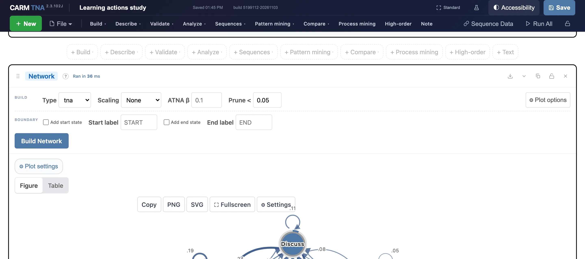</a>
<figcaption>The accessibility view enlarges text and controls and raises contrast across the notebook. The same button returns to the standard view.</figcaption>
</figure>

## Data

### Sample data

The Generate sample data button under the drop zone, also available as
File → Generate sample data…, creates a dataset in the browser. Nothing is
bundled in the notebook file; the data are drawn from a seeded model at the
moment of the click, so the same settings always produce the same data.

<figure>
<a href="guide/03-sample-dialog.webp">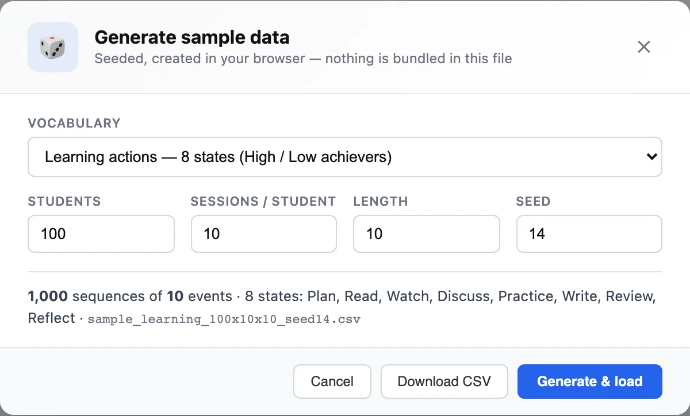</a>
<figcaption>The sample-data dialog. The summary line states what will be produced: 1,000 sequences of 10 events over 8 states, saved under the name sample_learning_100x10x10_seed14.csv.</figcaption>
</figure>

| Setting | Default | Meaning |
|---|---|---|
| Vocabulary | Learning actions, 8 states | The set of states and the profile structure of the generated students |
| Students | 100 | Number of actors |
| Sessions / student | 10 | Sessions per actor; each session becomes one sequence |
| Length | 10 | Events per session |
| Seed | 14 | Seed of the random draw |

The vocabularies are Learning actions (Plan, Read, Watch, Discuss, Practice,
Write, Review and Reflect, with a High and Low achievement group),
Engagement (Active, Moderate, Disengaged, with a third of the students in
each profile), Collaborative roles (Leader, Active, Moderator, Isolate, a
quarter each) and the learning-state categories metacognitive, cognitive,
behavioral, social, motivational and affective verbs, group regulation
(SSRL) and LMS events. In the profile vocabularies each student's own state
has a high probability of repeating, and the `group` column holds the
profile.

Generate & load loads the data exactly as a dropped file would be loaded.
Download CSV saves the same file for use in R or in another notebook. The
default sample has five columns: `student`, `session`, `timestamp`,
`action` and `achievement`. It is the running example of this guide.

### Own data

A dataset is dropped on the drop zone or chosen with File → Load Data. The
file is CSV or TSV with a header row; comma, tab, semicolon and pipe
delimiters are recognized. Spreadsheets are first saved as CSV UTF-8, since
Excel workbooks are not read directly.

Two layouts are accepted. A file in long format has one row per event.

```csv
Actor,Action,Time,Group
S01,Plan,2025-09-01 10:00:00,High
S01,Read,2025-09-01 10:02:10,High
S01,Practice,2025-09-01 10:05:41,High
S02,Read,2025-09-01 11:00:00,Low
S02,Watch,2025-09-01 11:03:12,Low
```

A file in wide format has one row per sequence and one column per position.

```csv
id,group,T1,T2,T3,T4
s01,Control,Plan,Read,Practice,Review
s02,Treatment,Read,Watch,Practice,Practice
```

The notebook guesses the layout from the column names and values and shows
its guess in the Format selector, where it can be changed.

### Mapping a long file

<figure>
<a href="guide/04-data-card.webp">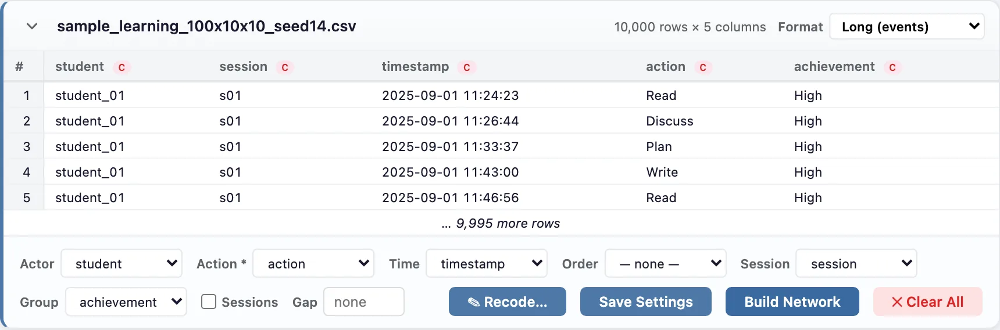</a>
<figcaption>The data card after the sample data are loaded: file name and size, the Format selector, a preview of the first rows and the column mapping. The notebook recognized student as Actor, action as Action, timestamp as Time, session as Session and achievement as Group.</figcaption>
</figure>

The data card shows the file name, the number of rows and columns, a
preview of the first rows with each column's detected type, and the column
mapping. The mapping tells the notebook how to turn rows into sequences.

| Control | Meaning |
|---|---|
| Actor | The column that identifies the person, team or case. Each actor's events form that actor's sequences. |
| Action | The column holding the state or event label. It is the only required column. |
| Time | A timestamp. Events are ordered by it within each actor, and it allows sessions to be cut by inactivity. Process mining uses it for durations. |
| Order | An explicit position used for sorting. It is never chosen automatically (see below). |
| Session | A column identifying sessions within an actor. Each actor × session pair becomes one sequence. |
| Group | A condition, cohort or class used by the Groups model and the comparisons. |
| Sessions | Cuts each actor's events into a new session after a period of inactivity given by Gap. It needs a Time column. Off, each actor (or each actor × Session pair) forms one sequence. |
| Gap | Inactivity in seconds that starts a new session. Ticking Sessions fills in 900, the default of R's `tna::prepare_data()`; 0 starts a new session on any gap; blank means no sessions. |

Without Time and Order, rows are taken in file order. The Order column is
sorted on, as in `tna::prepare_data()` and Nestimate. That is correct when
the column is a step index within each sequence and wrong when it restarts
inside a sequence, because sorting then gathers every step-1 row together.
When a chosen Order changes the event order of any sequence relative to file
order, the data card states in how many sequences it did so.

In the sample data each student has ten sessions, so student as Actor and
session as Session give 1,000 sequences of ten events each.

### Mapping a wide file

<figure>
<a href="guide/04b-wide-format.webp">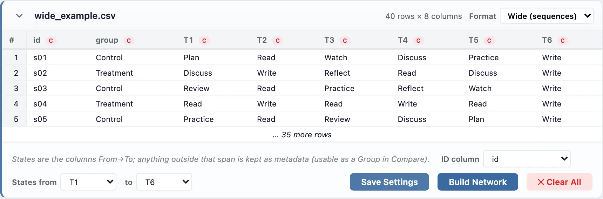</a>
<figcaption>A wide file of 40 sequences. The id column holds the sequence identifier, the states run from T1 to T6, and group stays outside the span as metadata.</figcaption>
</figure>

For a wide file the mapping has three controls. ID column names the column
that identifies each sequence; when it is left at none, the sequences are
numbered seq1, seq2 and so on. States from and to give the first and last
state column, and every column outside that span is kept as metadata that
can serve as a group later. The notebook proposes the span from the columns
that share one vocabulary of values, which is the signature of state
columns; the proposal is checked before building.

### Save Settings and Build Network

The data card has three buttons. Save Settings turns the rows into
sequences with the current mapping. The sequence analyses (sequence plots
and indices, pattern mining, process mining and several higher-order
methods) run on sequences alone and are available from this point. Build
Network does the same and also adds a Network cell, which estimates the
transition network that the network analyses need. Clear All keeps the data
but removes the sequences, the model and every cell.

<figure>
<a href="guide/06-collapsed-card.webp"></a>
<figcaption>After the first build the data card folds into one line with the file name, its size and the saved mapping. A click on the line opens it again.</figcaption>
</figure>

When the mapping is changed after a build, the card shows a re-run notice:
the cells keep their results until Save Settings or Build Network applies
the new mapping. Change dataset, at the top right of the card, replaces the
data and keeps the cells, which are then rerun on the new data.

### Checking the sequences

<figure>
<a href="guide/07-sequence-data.webp">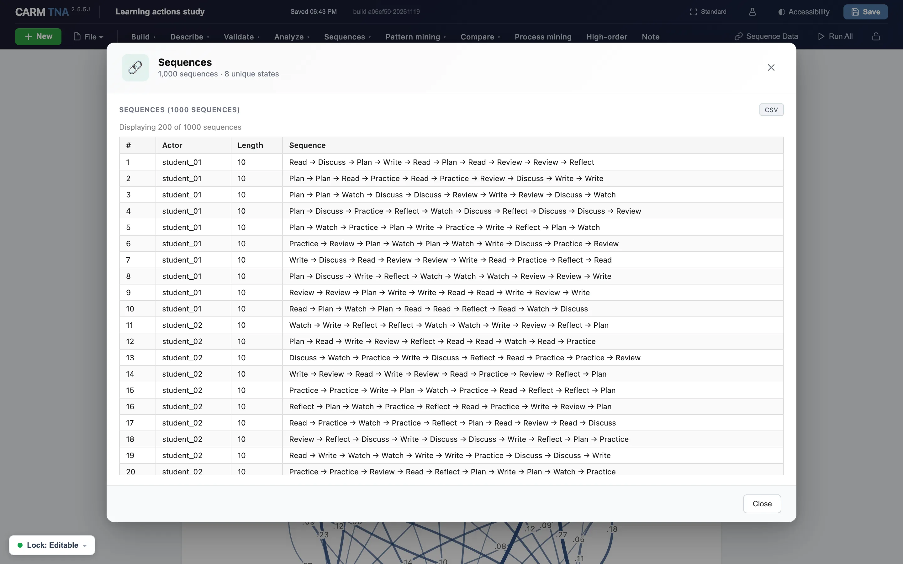</a>
<figcaption>The Sequence Data window lists every processed sequence with its actor and length. Here: 1,000 sequences over 8 unique states. CSV downloads the list.</figcaption>
</figure>

Sequence Data, in the toolbar, opens the sequences that the analyses
actually receive. This is the place to confirm that the mapping produced the
intended cases: the number of sequences, their actors, their lengths and the
order of states within them.

## Working with cells

### Adding a cell

<figure>
<a href="guide/09-validate-menu.webp">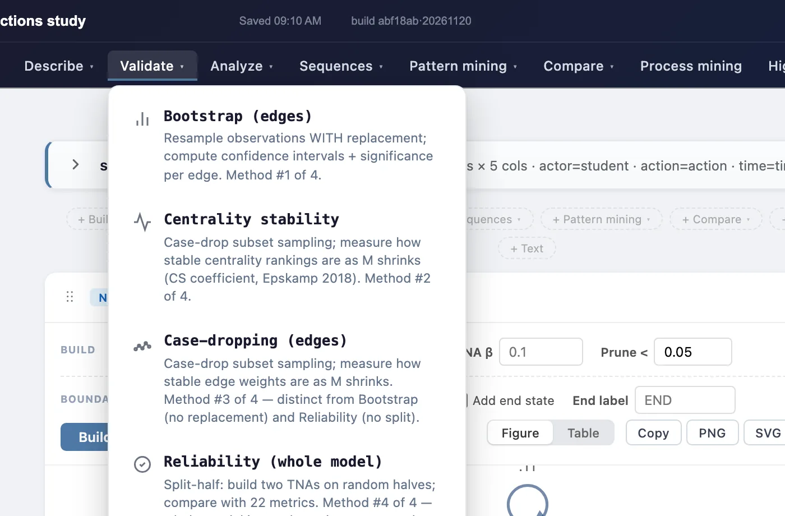</a>
<figcaption>The Validate menu. Each item names a cell and gives a one-line description of it.</figcaption>
</figure>

Each menu item adds one cell at the end of the notebook. The row of + menus
that appears between cells inserts a cell at that position instead. A cell
can be added before its prerequisites exist; it then says what it needs,
for example that the data settings must be saved first.

### The parts of a cell

<figure>
<a href="guide/05-network-cell.webp">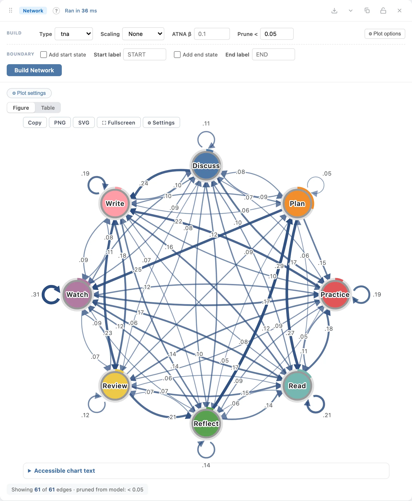</a>
<figcaption>A Network cell. The header row carries the cell type, a help button, the run time and the cell controls; below it are the form, the run button and the result.</figcaption>
</figure>

Every cell has the same parts. The header names the cell type and shows the
time of the last run. The ? button opens the cell's help. The controls at
the right of the header export the result, minimize the cell, duplicate it
with its settings, lock it, and remove it. The grip at the left moves the
cell; Alt with the Up or Down arrow moves it with the keyboard.

The form holds the cell's settings, and the run button below it (Build
Network, Run Bootstrap, Detect Communities and so on) computes the result
with them. Settings take effect only when the cell runs again. A locked cell
keeps its settings and its last result and is skipped by Run All.

Below the form is the result. Results with both a figure and a table show
Figure and Table tabs. Each figure has its own toolbar: Copy places the
figure on the clipboard as an image, PNG downloads a 600 DPI raster, SVG
downloads a vector file, Fullscreen enlarges it, and Settings opens the plot
options. Under each figure, Accessible chart text holds a text description
of what the chart shows.

<figure>
<a href="guide/12-network-table.webp">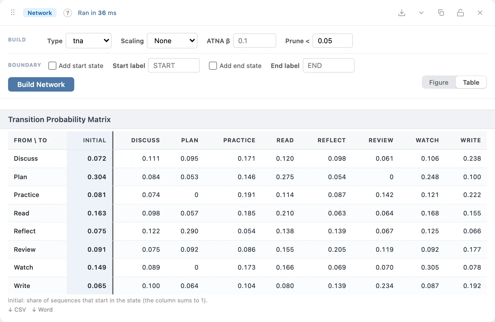</a>
<figcaption>The Table tab of the Network cell lists the edges with their weights.</figcaption>
</figure>

<figure>
<a href="guide/10-cell-export.webp">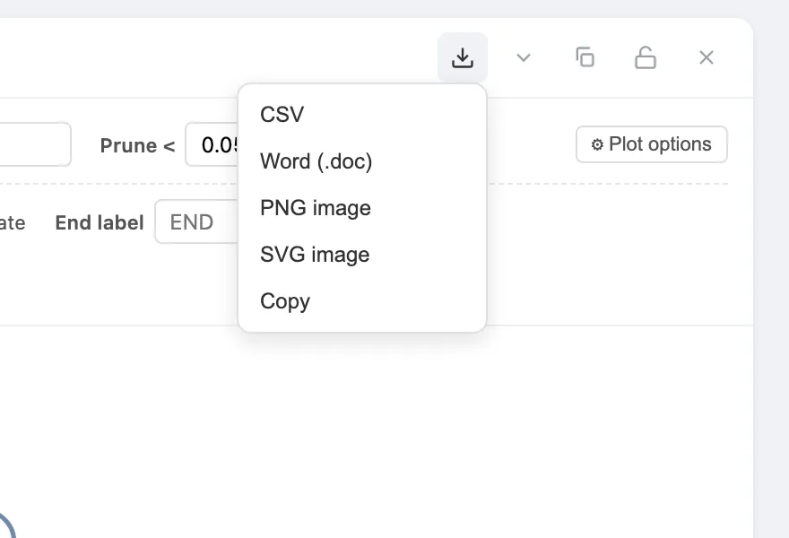</a>
<figcaption>The Export menu in the cell header: CSV, Word, PNG and SVG files of the cell's result, or a copy to the clipboard.</figcaption>
</figure>

Tables are paged. The control above each table sets the number of rows per
page, and its Export menu copies the table as TSV or Markdown or downloads
it as CSV, TSV, JSON, Markdown, HTML or Word.

### Plot options

The Plot settings button above a network plot, and Settings in its toolbar,
open the plot options. The options apply at once to every network plot in
the notebook; they change the drawing only and leave the model unchanged.

<figure>
<a href="guide/11-plot-settings.webp">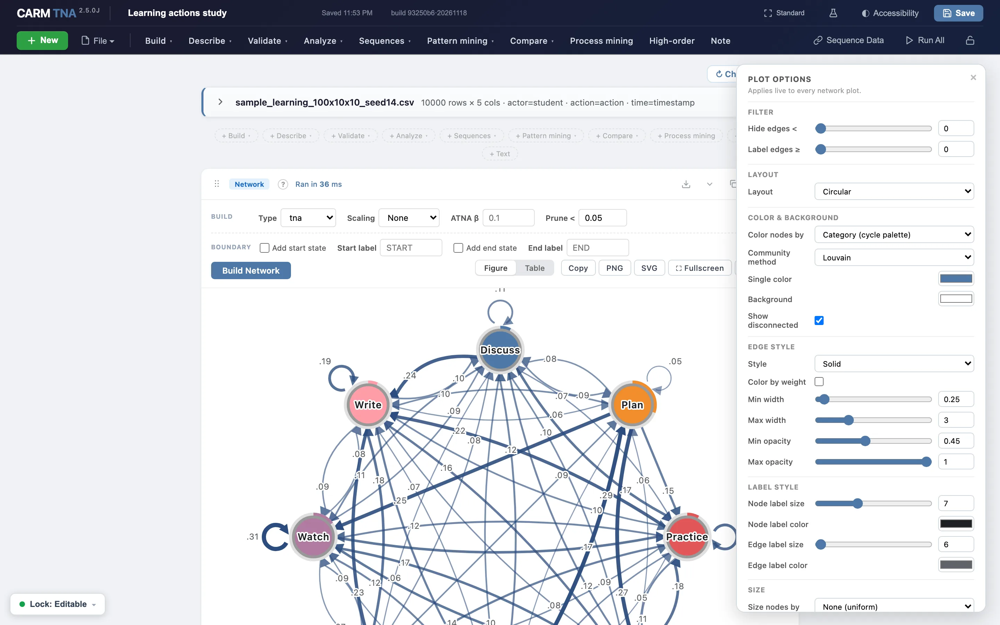</a>
<figcaption>The plot options open beside the notebook. Changes apply immediately to every network plot.</figcaption>
</figure>

<figure>
<a href="guide/11b-plot-options-panel.webp">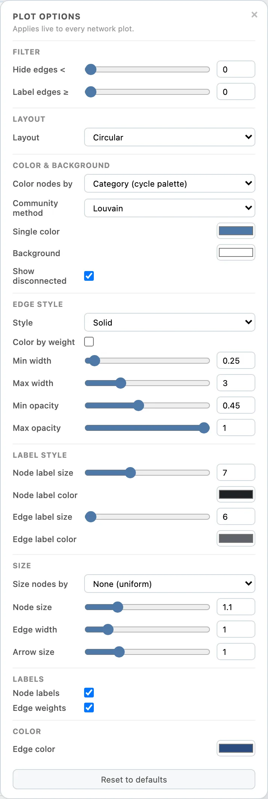</a>
<figcaption>The complete plot options panel.</figcaption>
</figure>

| Group | Options |
|---|---|
| Filter | Hide edges below a weight; show numeric labels only on edges at or above a weight. |
| Layout | Circular, spring, concentric, radial tree, grid, seeded random, bipartite, spectral, shell by community, star, spiral, hierarchical, MDS, Fruchterman-Reingold, Kamada-Kawai, arc diagram, dual circle, community grouped and degree sorted. |
| Color & background | Node colors by category, community (with a choice of Louvain, Walktrap, Fast Greedy, Label propagation or Eigenvector), centrality, or one color; background color; whether disconnected states are shown. |
| Edge style | Solid, dashed or dotted lines; color by weight; minimum and maximum width and opacity. |
| Label style | Size and color of node labels and edge labels. |
| Size | Node size by OutStrength, InStrength, Betweenness, Closeness or PageRank, or uniform; node, edge and arrow scale. |

Reset to defaults, at the bottom of the panel, restores the standard
appearance. Hide edges changes only what is drawn. The Prune setting of the
Network cell removes edges from the model itself, which changes every
analysis downstream.

### Group axis

Many cells have a Group axis control. It decides whether the cell analyses
one network or one network per group, and which grouping it uses.

| Option | Grouping |
|---|---|
| Auto (active) | The grouping of the most recent Groups, Cluster sequences or Mixture Markov model cell; one network when none exists. |
| Group column | The Group column of the data mapping. |
| Clusters | The clusters of the most recent clustering cell. |
| Last observation | Groups sequences by their final state. |

In this guide a Groups cell on achievement is added first, so the cells that
follow show the High and Low groups side by side.

### Running and locking

Run All runs every unlocked cell from top to bottom. It is the quickest way
to bring a notebook up to date after the data or the mapping has changed.
Resampling cells with many iterations can make a full run slow; locking
finished cells, or running expensive cells one at a time, avoids repeating
them. The lock icon at the right of the toolbar locks or unlocks all cells
at once.

## Build: the models

### Network

The Network cell estimates the transition network from the sequences. It is
added by Build → Network or by the Build Network button of the data card,
and the network analyses use the model it builds.

<figure>
<a href="guide/05b-network-form.webp">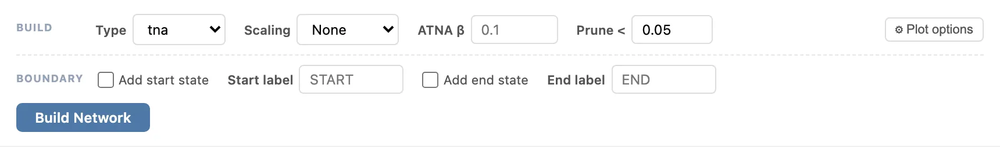</a>
<figcaption>The Network cell's settings.</figcaption>
</figure>

| Control | Default | What it sets |
|---|---|---|
| Type | tna | Options: tna, ftna, ctna, atna. |
| Scaling | None | Options: None, Min-Max, Max, Rank. |
| ATNA β | empty (0.1) | ATNA attention decay β — controls how fast attention falls off with distance. Only used when Type = atna; ignored for other types. Empty = engine default (0.1). |
| Prune &lt; | 0.05 | Remove edges below this weight from the model (affects all downstream analyses) |
| Add start state | off | Inject a synthetic START state at position 0 of every sequence before building. Propagates to model.data so downstream verbs (Reliability, Bootstrap, etc.) see the boundaries too. |
| Start label | empty (START) | Label used for the injected start state. Default: START. |
| Add end state | off | Inject a synthetic END state at the end of every sequence (after trailing nulls are stripped). Useful when sequence termination carries semantic meaning. |
| End label | empty (END) | Label used for the injected end state. Default: END. |

The model types estimate different quantities.

| Type | Edge weight | Typical use |
|---|---|---|
| tna | The probability of moving to the target state, given the source state; each row sums to one | Relative transition tendencies; the default |
| ftna | The number of observed transitions | When the volume of transitions matters |
| ctna | Co-occurrence of the two states within the same sequence | When co-presence matters more than direction |
| atna | Transitions weighted by an attention kernel that decays with distance (ATNA β) | When states further apart in a sequence should still contribute |

Scaling rescales the weights after estimation (min-max to 0–1, division by
the maximum, or ranks). Prune removes edges below the threshold from the
model; with the default of 0.05 the sample network keeps all 61 of its
edges above that weight. Add start state and Add end state insert synthetic
START and END states, so that how sequences begin and end becomes part of
the network; the resampling cells inherit these boundaries.

The figure plots the states as nodes and the transitions as arrows, with the
weight printed on each edge. The colored arc around each node shows its
initial probability, the share of sequences that start in that state, and
self-loops are drawn as loops beside the node. In the sample data the
strongest self-loop is Watch → Watch (.31).

### Groups

<figure class="fig-tall">
<a href="guide/cell-group.webp">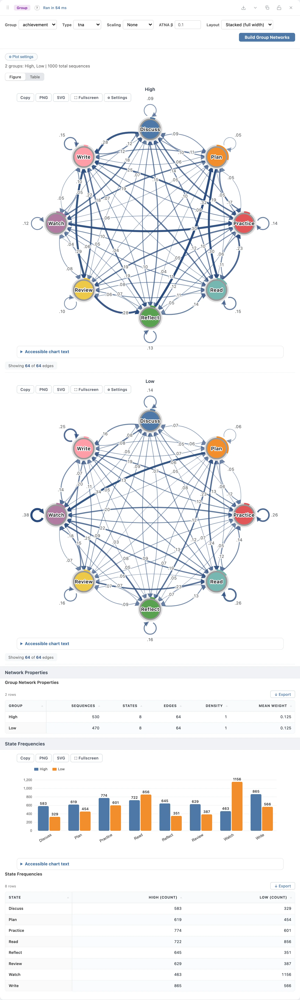</a>
<figcaption>Groups on the achievement column: one network for the 530 sequences of the High group and one for the 470 sequences of the Low group, followed by summary tables.</figcaption>
</figure>

The Groups cell estimates one network per value of a grouping column. It is
the basis for every comparison of groups.

| Control | Default | What it sets |
|---|---|---|
| Group | achievement | Options: student, session, timestamp, action, achievement. |
| Type | tna | Options: tna, ftna, ctna, atna. |
| Scaling | None | Options: None, Min-Max, Max, Rank. |
| ATNA β | empty (0.1) | ATNA attention decay β — only used when Type = atna; ignored for other types. Empty = engine default (0.1). |
| Layout | Stacked (full width) | Options: Stacked (full width), Grid 2-col, Grid 3-col. |

Each sequence belongs to the group of its first row. Small groups produce
networks with large sampling error, so differences between them are assessed
with the Compare cells before they are interpreted.

### Cluster sequences

<figure class="fig-tall">
<a href="guide/cell-cluster.webp">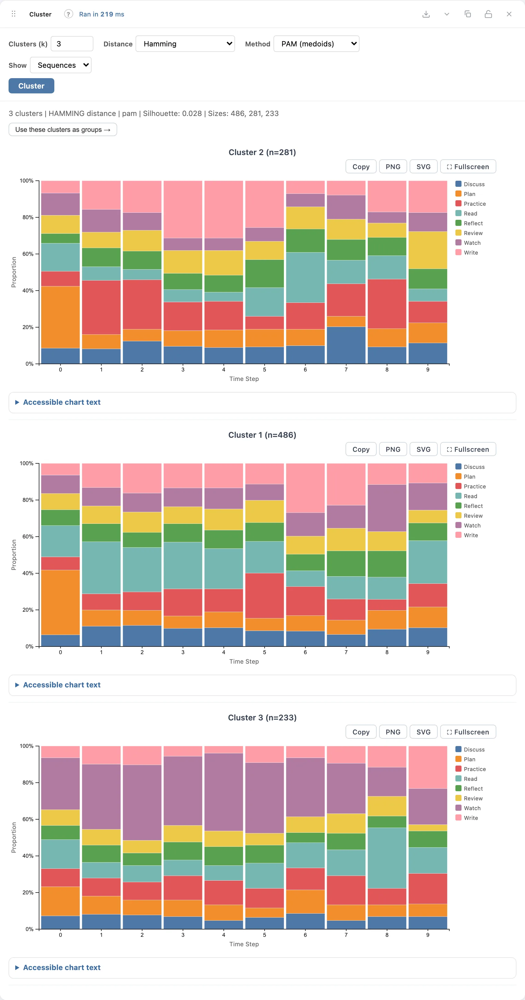</a>
<figcaption>Three clusters from Hamming distances and PAM. The header line reports a silhouette of 0.028 and cluster sizes of 486, 281 and 233; each cluster is shown as a state distribution plot.</figcaption>
</figure>

Cluster sequences groups the sequences by their similarity and can then
estimate one network per cluster.

| Control | Default | What it sets |
|---|---|---|
| Clusters (k) | 3 | — |
| Distance | Hamming | Options: Hamming, Levenshtein, OSA, Damerau-Levenshtein, LCS, Q-gram, Cosine, Jaccard, Jaro-Winkler. |
| Method | PAM (medoids) | Options: PAM (medoids), Complete, Average (UPGMA), Single, Ward D, Ward D², McQuitty, Median, Centroid. |
| Show | Sequences | Options: Sequences, Table, TNA. |
| Type | tna | Options: tna, ftna, ctna, atna. (Shown only with some settings.) |
| Layout | Stacked (full width) | Options: Stacked (full width), Grid 2-col, Grid 3-col. (Shown only with some settings.) |

The distance measures compare sequences position by position (Hamming), by
the edits that turn one into the other (Levenshtein, OSA,
Damerau-Levenshtein), by their longest common subsequence (LCS), or by the
sets of states and short substrings they contain (Q-gram, Cosine, Jaccard,
Jaro-Winkler). Hamming suits aligned sequences of equal length. The
silhouette coefficient in the header measures how well separated the
clusters are; values near zero, as in the sample data, indicate that the
sequences do not form distinct clusters. Show selects state distribution
plots, a membership table, or a TNA network per cluster.

### Mixture Markov model

<figure class="fig-tall">
<a href="guide/cell-mmm.webp">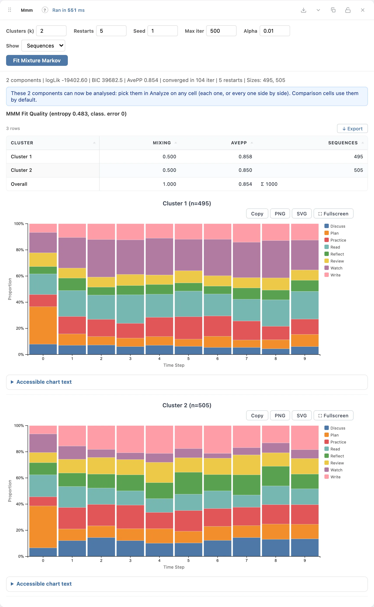</a>
<figcaption>A two-component mixture Markov model with five restarts. The header reports the log-likelihood (−19402.60), the BIC (39682.5), the average posterior probability (0.854), convergence in 104 iterations and component sizes of 495 and 505.</figcaption>
</figure>

The mixture Markov model finds latent groups of sequences that follow
different transition processes. Each component is a Markov chain, and every
sequence has a posterior probability of belonging to each component. The
model is fitted by expectation-maximization.

| Control | Default | What it sets |
|---|---|---|
| Clusters (k) | 2 | Number of latent mixture components (clusters) to fit. |
| Restarts | 1 | Independent EM restarts from different seeded inits; best log-likelihood wins. 1 = single deterministic start. |
| Seed | 1 | RNG seed. With Restarts=R the seeds used are seed..seed+R-1; results are fully deterministic for a fixed (data, seed). |
| Max iter | 200 | Maximum EM iterations per start. Default 200, as Nestimate cluster_mmm(max_iter = 200L). |
| Alpha | 0.01 | Laplace smoothing on transition counts. 0 = MLE (risky on sparse data — unseen pairs get zero probability). 0.01 = Nestimate/seqHMM default (tiny prior, recommended). 0.5 = Krichevsky-Trofimov Bayesian default. 1 = classical Laplace add-one. |
| Show | Sequences | Options: Sequences, Table, TNA. |
| Layout | Stacked (full width) | Options: Stacked (full width), Grid 2-col, Grid 3-col. (Shown only with some settings.) |

Expectation-maximization can stop in a local optimum, so a model is fitted
from several starts and the best log-likelihood is kept. The figure uses
five restarts; all five reached the same log-likelihood. The header reports
whether the fit converged within Max iter; a fit that did not converge is
refitted with a higher cap. The fit-quality table gives each component's
mixing proportion, its average posterior probability (AvePP) and its
size; an AvePP close to one indicates well-separated components. Alpha adds
a small count to every transition so that transitions unseen in a component
keep a non-zero probability.

## Describe

### State frequencies

<figure>
<a href="guide/cell-states-freq.webp">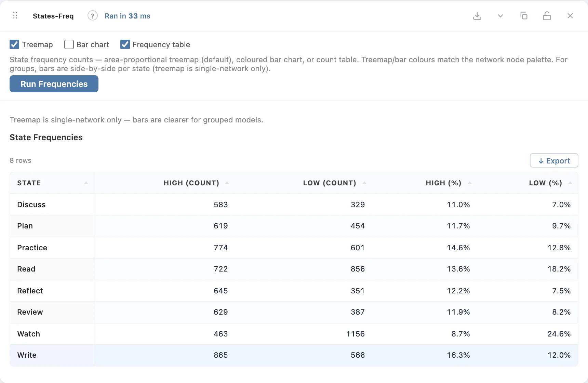</a>
<figcaption>State frequencies for the High and Low groups. Watch accounts for 8.7% of High events and 24.6% of Low events.</figcaption>
</figure>

| Control | Default | What it sets |
|---|---|---|
| Treemap | on | — |
| Bar chart | off | — |
| Frequency table | on | — |

The treemap shows each state as an area proportional to its frequency and
appears for a single network; with groups the cell shows bars and a table
per group. Frequencies describe how common each state is and say nothing
about the order of states.

### State mosaic

<figure>
<a href="guide/cell-states-mosaic.webp">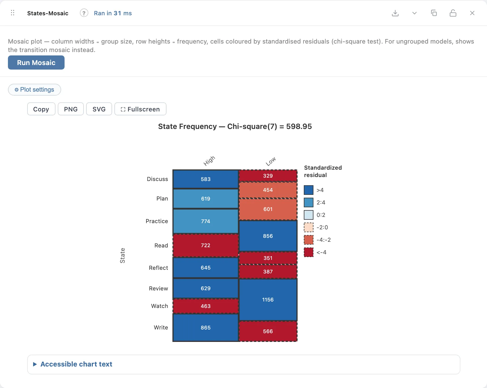</a>
<figcaption>The state mosaic for High and Low. Column widths follow group size and row heights follow state frequency; colors show standardized residuals. The test of independence gives χ²(7) = 598.95.</figcaption>
</figure>

*This cell has no settings; it runs on the current model.*

For groups, the mosaic crosses group and state and colors each cell by its
standardized residual under independence: blue cells occur more often than
independence predicts and red cells less often. Large residuals mark
departures from independence, which in large samples can be small in
practical terms. For a single network the cell plots a transition mosaic.

### Transition weights

<figure>
<a href="guide/cell-states-weights.webp">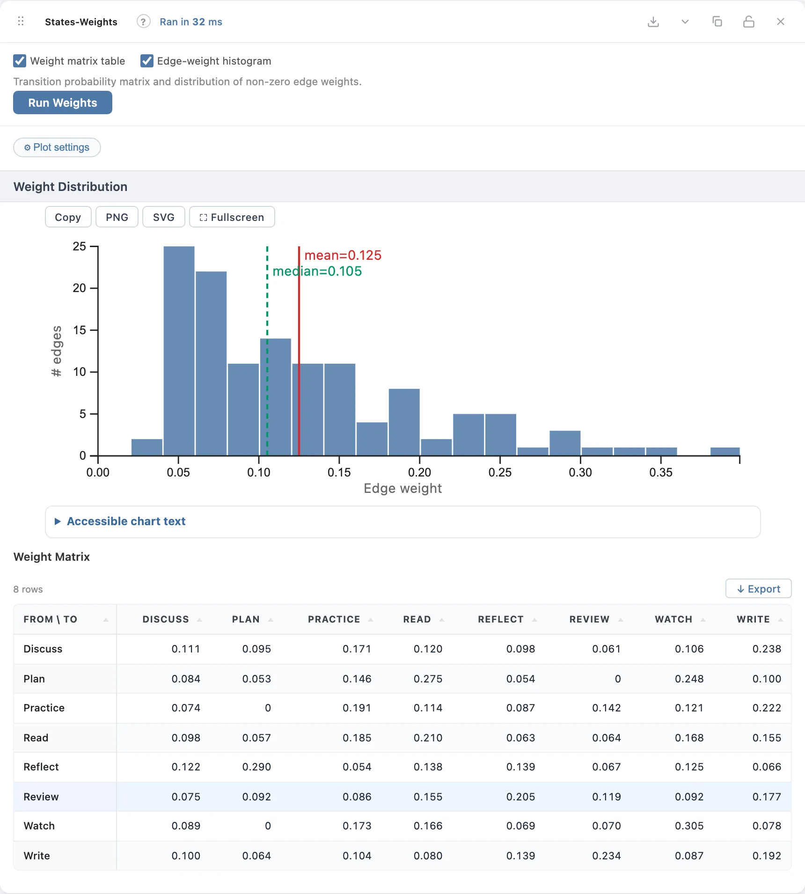</a>
<figcaption>The edge-weight histogram and the weight matrix. The mean edge weight is 0.125 and the median 0.105.</figcaption>
</figure>

| Control | Default | What it sets |
|---|---|---|
| Weight matrix table | on | — |
| Edge-weight histogram | on | — |

The weight matrix lists the weight from each row state to each column
state. The histogram shows the distribution of non-zero weights, which helps
in choosing a pruning threshold.

## Validate

The Validate menu holds four resampling methods and a test of the Markov
order. The resampling methods answer different questions.

| Cell | Resampling | Question |
|---|---|---|
| Bootstrap (edges) | Sequences drawn with replacement | Which edges are stable? |
| Centrality stability | Increasing shares of sequences dropped | Are the centrality rankings stable? |
| Case-dropping (edges) | Increasing shares of sequences dropped | Is the whole edge-weight pattern stable? |
| Reliability (whole model) | Random split into two halves | How similar are networks estimated from two halves of the data? |

### Bootstrap (edges)

<figure class="fig-tall">
<a href="guide/cell-bootstrap.webp">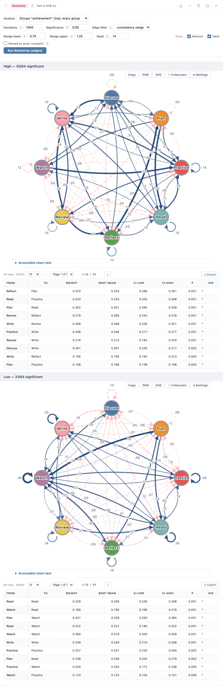</a>
<figcaption>Bootstrap of the High and Low networks with 1,000 resamples: 35 of 64 edges are significant in the High network. Significant edges are drawn solid and the others dashed; the table lists each edge's weight, bootstrap mean, confidence interval and p-value.</figcaption>
</figure>

The bootstrap draws sequences with replacement, re-estimates the network on
each draw, and records every edge's weight. An edge is significant when its
weight stays within the consistency range around the original weight
(0.75 to 1.25 times by default) in at least 95% of the resamples, or, with
the probability cutoff, when its bootstrap weight stays above the cutoff.

| Control | Default | What it sets |
|---|---|---|
| Iterations | 1000 | — |
| Significance | 0.05 | — |
| Edge filter | consistency range | Consistency range: keep edges whose bootstrap mean falls in [lower, upper]. Probability cutoff: keep edges whose bootstrap mean ≥ cutoff. Options: consistency range, probability cutoff. |
| Range lower | 0.75 | Lower bound of the consistency range — edges with bootstrap mean below this are flagged unstable. |
| Range upper | 1.25 | Upper bound of the consistency range — edges with bootstrap mean above this are flagged unstable. |
| Cutoff | 0.05 | Probability cutoff — only edges whose bootstrap mean ≥ this value are kept. Used only when Edge filter = probability cutoff. (Shown only with some settings.) |
| Seed | 14 | Seed for reproducibility (default 14). Clear to use the engine's default seed. |
| Network | on | — |
| Table | on | — |

The table reports for each edge the original weight, the bootstrap mean,
the confidence interval and the p-value. A thousand iterations are the usual
minimum; an edge close to the threshold needs more.

### Centrality stability

<figure class="fig-tall">
<a href="guide/cell-stability.webp">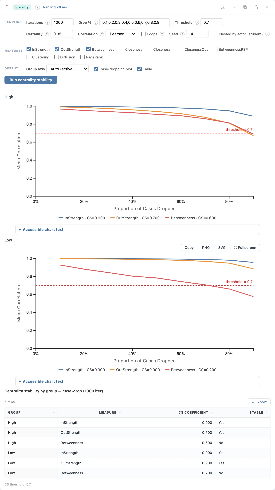</a>
<figcaption>Case-dropping curves for the High and Low groups. The correlation between centralities in the full data and in the reduced data is plotted against the share of sequences dropped; the dashed line marks the threshold of 0.7.</figcaption>
</figure>

Centrality stability estimates the correlation-stability (CS) coefficient
of Epskamp, Borsboom and Fried (2018): the largest share of sequences that
can be dropped while the correlation between the original centralities and
those from the reduced data stays at or above the threshold in the required
share of resamples.

| Control | Default | What it sets |
|---|---|---|
| Iterations | 1000 | Resamples per drop proportion. R default: 1000 (estimate_cs in tna 1.2.1). Lower for quick exploration. |
| Drop % | 0.1,0.2,0.3,0.4,0.5,0.6,0.7,0.8,0.9 | Comma-separated proportions of cases to drop at each step (engine default 0.1,0.2,…,0.9). Empty = engine default. |
| Threshold | 0.7 | CS threshold the correlation has to maintain (default 0.7) |
| Certainty | 0.95 | CS certainty level — the fraction of resamples required to be above the threshold (default 0.95) |
| Correlation | Pearson | Correlation method used to compare centrality vectors across drops Options: Pearson, Spearman, Kendall. |
| Loops | off | Include self-loops when computing centralities. R default: FALSE (estimate_cs in tna 1.2.1). |
| Seed | 14 | Seed for reproducibility (default 14). Clear to use the engine's default seed. |
| Group axis | Auto (active) | Group axis: Auto=last-built group/clustering; Clusters=last clustering run; Column=re-derive from group column; Last observation=group by final state of each sequence. Options: Auto (active), Group column, Clusters, Last observation. |
| Case-dropping plot | on | — |
| Table | on | — |

The table's Stable column marks a measure whose CS coefficient reaches the
Threshold setting, 0.7 by default. Epskamp, Borsboom and Fried (2018)
recommend that the coefficient be at least 0.25 and preferably 0.5. In the
sample data InStrength reaches 0.9 in both groups, while Betweenness reaches
0.6 in the High group and 0.2 in the Low group, so betweenness rankings of
the Low network are not interpretable.

### Case-dropping (edges)

<figure>
<a href="guide/cell-edge-reliab.webp">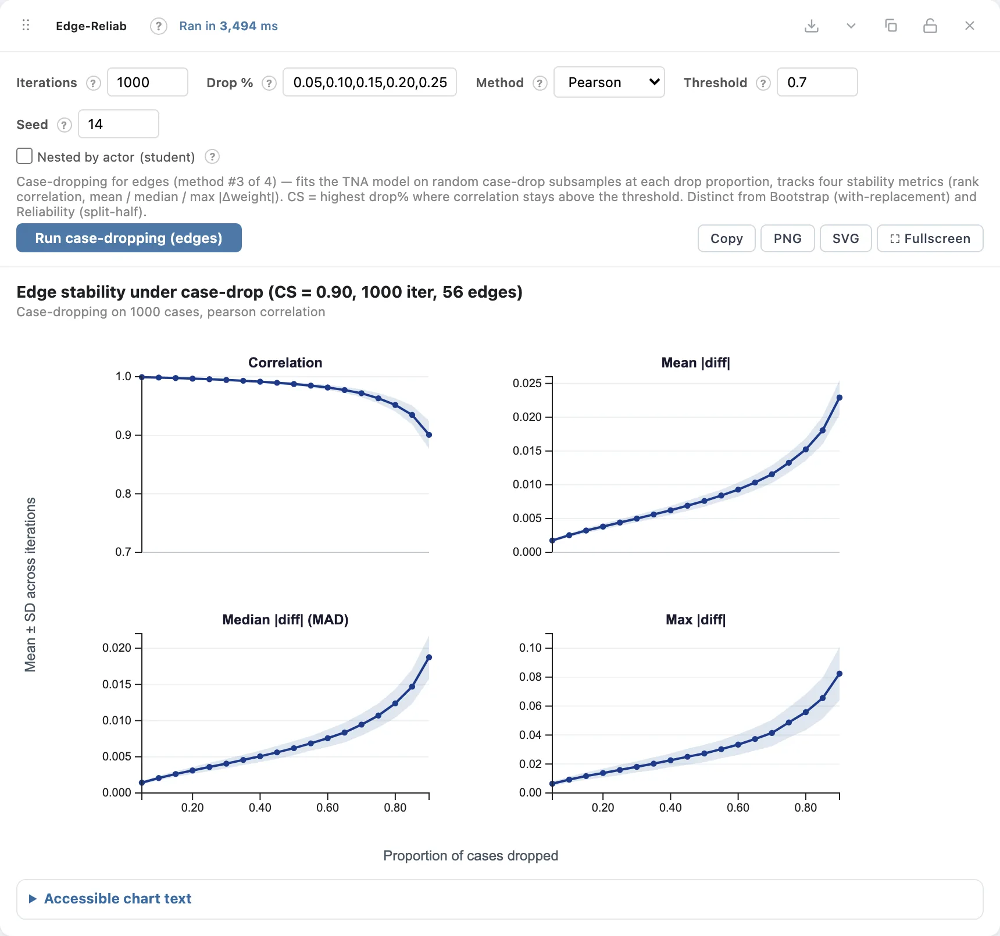</a>
<figcaption>Edge stability under case-dropping: correlation and absolute differences between the full and reduced edge weights. The CS coefficient for the edges is 0.90.</figcaption>
</figure>

Case-dropping for edges applies the same procedure to the vector of edge
weights. It reports the correlation between the full and reduced networks
and the mean, median and maximum absolute weight difference at each drop
level, and an edge-stability coefficient defined like the CS coefficient.

| Control | Default | What it sets |
|---|---|---|
| Iterations | 1000 | Number of case-drop iterations per proportion. R default: 1000 (estimate_es in tna 1.2.1). Lower for quick exploration. |
| Drop % | 0.05,0.10,0.15,0.20,0.25,0.30,0.35,0.40,0.45,0.50,0.55,0.60,0.65,0.70,0.75,0.80,0.85,0.90 | Comma-separated proportions of cases to drop. R default: seq(0.05, 0.9, by = 0.05) — 5 % steps. |
| Method | Pearson | Correlation method used to compare edge-weight vectors. R default: pearson. Options: Pearson, Spearman, Kendall. |
| Threshold | 0.7 | Threshold the correlation has to maintain (default 0.7) |
| Seed | 14 | Seed for reproducibility (default 14). Clear to use the engine's default seed. |

### Reliability (whole model)

<figure>
<a href="guide/cell-reliability.webp">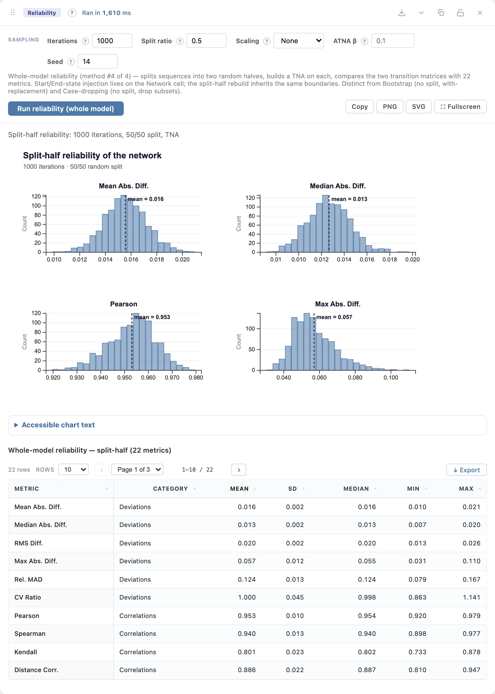</a>
<figcaption>Split-half reliability with 1,000 random splits. The mean absolute difference between the two halves' edge weights averages 0.016, and their Pearson correlation averages 0.953.</figcaption>
</figure>

The split-half reliability splits the sequences at random into two halves,
estimates a network on each half and compares the two networks with 22
measures of difference, correlation and similarity. The distributions over
many splits show how consistently the data determine the network.

| Control | Default | What it sets |
|---|---|---|
| Iterations | 1000 | Number of random splits to perform. R default: 1000 (reliability in tna 1.2.1). Lower for quick exploration. |
| Split ratio | 0.5 | Fraction of sequences placed in the first half (the rest go to the second half) |
| Scaling | None | Scaling applied to the split-half models before comparison. Leave None to inherit from the parent network. Options: None, Min-Max, Max, Rank. |
| ATNA β | empty (0.1) | ATNA attention decay β (only used when the model type is ATNA). Empty = engine default (0.1). |
| Seed | 14 | Seed for reproducibility (default 14). Clear to use the engine's default seed. |

### Markov order test

<figure>
<a href="guide/cell-markov-order.webp">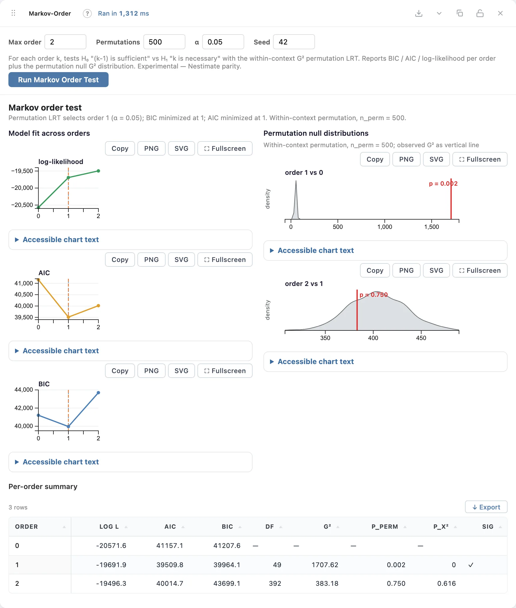</a>
<figcaption>The Markov order test selects order 1: the permutation likelihood-ratio test, BIC and AIC all favour the first-order model.</figcaption>
</figure>

A transition network is a first-order Markov model: the next state depends
only on the current one. The Markov order test asks whether conditioning on
more past states improves the prediction. For each order k it compares
order k with order k − 1 by a likelihood-ratio test whose null distribution
comes from permutations within contexts, and it reports AIC and BIC for each
order.

| Control | Default | What it sets |
|---|---|---|
| Max order | 2 | Highest Markov order to test. 2 is a safe default; order ≥3 can OOM on large datasets because the k-gram state space grows fast. |
| Permutations | 500 | Within-context permutations per order |
| α | 0.05 | Significance level for sequential order selection |
| Seed | 42 | RNG seed for reproducible permutations |

When order 1 is selected, as in the sample data, the transition network is
an adequate summary. A higher order points to the methods in
[High-order](#high-order). The number of contexts grows quickly with the
order, so orders above 2 or 3 can exhaust memory on large data.

## Analyze

### Centrality measures

<figure class="fig-tall">
<a href="guide/cell-centrality.webp">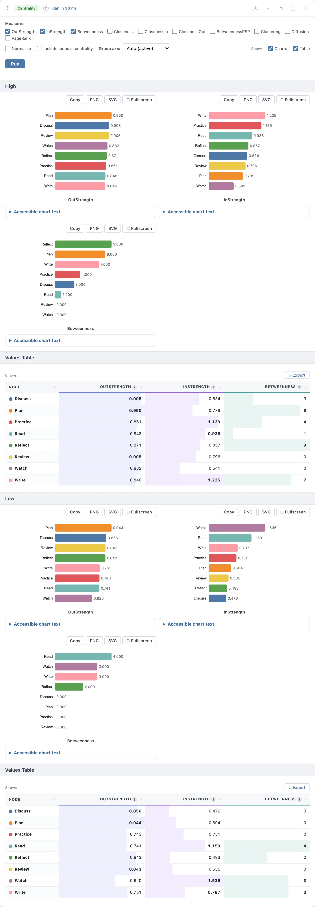</a>
<figcaption>Centralities for the High and Low networks. In the High network Write has the highest InStrength (1.225).</figcaption>
</figure>

Centralities rank states by their position in the network.

| Control | Default | What it sets |
|---|---|---|
| Normalize | off | — |
| Include loops in centrality | off | Include self-loops when computing centralities. R default: FALSE (matches centralities() in tna 1.2.1). |
| Group axis | Auto (active) | Group axis: Auto=last-built group/clustering; Clusters=last clustering run; Column=re-derive from group column; Last observation=group by final state of each sequence. Options: Auto (active), Group column, Clusters, Last observation. |
| Charts | on | — |
| Table | on | — |

The Measures checkboxes select among ten measures; OutStrength, InStrength
and Betweenness are selected by default.

| Measure | Meaning in a transition network |
|---|---|
| OutStrength | Sum of the outgoing weights. With self-loops excluded, in a tna model it is one minus the self-loop weight, so it measures how readily the process leaves the state. |
| InStrength | Sum of the incoming weights: how much of the process flows into the state. |
| Betweenness | How often the state lies on the shortest paths between other states. |
| Closeness, ClosenessIn, ClosenessOut | How near the state is to the others along shortest weighted paths, in both directions, inward or outward. |
| BetweennessRSP | Betweenness along randomized shortest paths. |
| Clustering | How strongly the state's neighbours are connected among themselves. |
| Diffusion | The state's reach in a diffusion process over the network. |
| PageRank | The long-run share of a random walk that visits the state. |

Self-loops are excluded by default, as in R's `tna::centralities()`.
Centralities are interpreted together with their stability (see
[Centrality stability](#centrality-stability)).

### Edge betweenness plot

<figure class="fig-tall">
<a href="guide/cell-betweenness.webp">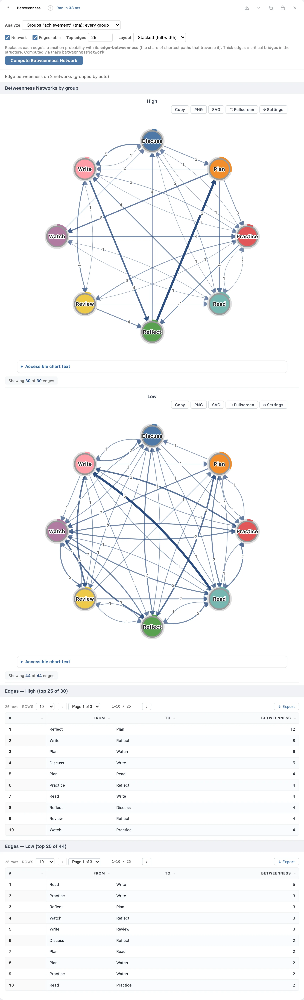</a>
<figcaption>Edge betweenness of the High and Low networks. The width of each edge is its betweenness.</figcaption>
</figure>

Edge betweenness counts how many shortest paths between states pass along
each transition. Transitions with high betweenness connect otherwise
separate parts of the process. The plotted width shows betweenness, not the
transition probability.

| Control | Default | What it sets |
|---|---|---|
| Network | on | — |
| Edges table | on | — |
| Top edges | 25 | Show only the top-N edges in the table |
| Layout | Stacked (full width) | Options: Stacked (full width), Grid 2-col, Grid 3-col. |
| Group axis | Auto (active) | Group axis: Auto=last-built group/clustering; Clusters=last clustering run; Column=re-derive from group column; Last observation=group by final state of each sequence. Options: Auto (active), Group column, Clusters, Last observation. |

### Community detection

<figure>
<a href="guide/cell-community.webp">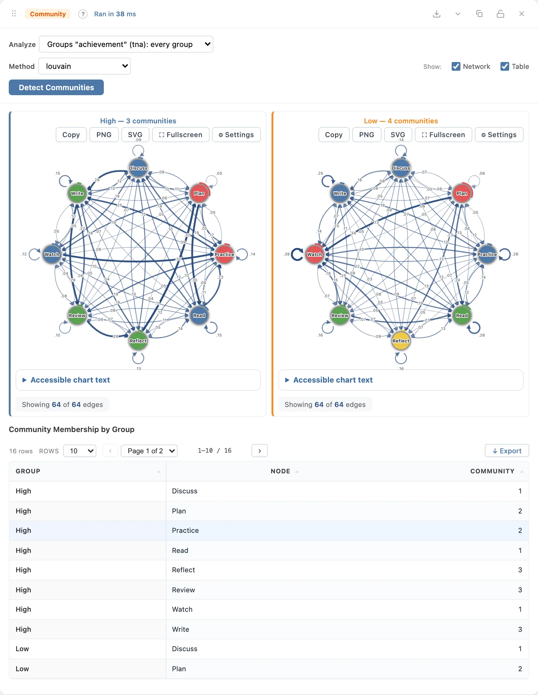</a>
<figcaption>Louvain communities: three in the High network and four in the Low network, with a membership table.</figcaption>
</figure>

Community detection finds groups of states with stronger transitions among
themselves than to the rest of the network.

| Control | Default | What it sets |
|---|---|---|
| Method | louvain | Options: louvain, walktrap, fast_greedy, label_prop, leading_eigen, edge_betweenness. |
| Group axis | Auto (active) | Group axis: Auto=last-built group/clustering; Clusters=last clustering run; Column=re-derive from group column; Last observation=group by final state of each sequence. Options: Auto (active), Group column, Clusters, Last observation. |
| Network | on | — |
| Table | on | — |

The algorithms optimize different criteria and can return different
partitions of the same network: Louvain and fast greedy maximize
modularity, Walktrap follows short random walks, label propagation spreads
labels between neighbours, leading eigenvector uses the modularity matrix,
and edge betweenness removes bridging edges in turn.

### Cliques

<figure class="fig-tall">
<a href="guide/cell-cliques.webp">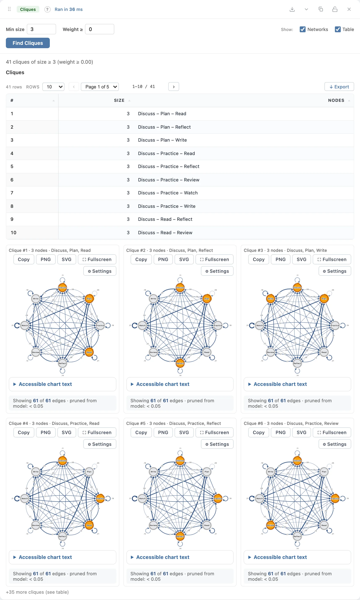</a>
<figcaption>Cliques of at least three states in the sample network: 41 cliques, each listed with its states and plotted on the network.</figcaption>
</figure>

A clique is a set of states in which every pair is connected. Directed
transitions are treated as connections for this purpose.

| Control | Default | What it sets |
|---|---|---|
| Min size | 3 | Minimum number of nodes in a clique |
| Weight ≥ | 0 | Ignore edges below this weight when detecting cliques |
| Networks | on | — |
| Table | on | — |

A probability network without pruning is often nearly complete, in which
case almost every set of states is a clique. Raising Weight ≥ restricts
cliques to strong transitions.

## Sequences

### Sequences

<figure>
<a href="guide/cell-sequences.webp">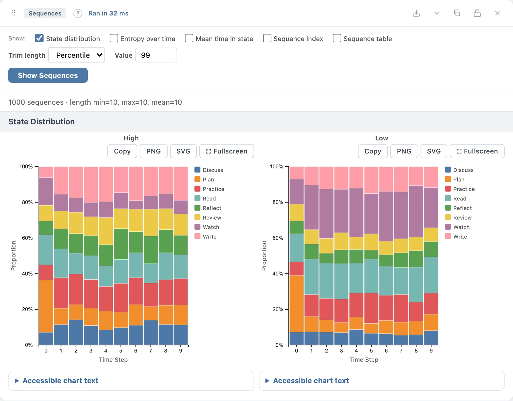</a>
<figcaption>The state distribution plot for the High and Low groups: the share of each state at each position of the 1,000 sequences of length 10.</figcaption>
</figure>

The Sequences cell plots the sequences themselves.

| Control | Default | What it sets |
|---|---|---|
| State distribution | on | — |
| Entropy over time | off | — |
| Mean time in state | off | — |
| Sequence index | off | — |
| Sequence table | off | — |
| Trim length | Percentile | Clip long sequences so a few outliers do not dominate the plot. Percentile keeps the shortest length that still covers N% of sequences. Fixed caps every sequence at a hard number of steps. Options: Percentile, Fixed, None. |
| Value | 99 | Percent (1–99) for Percentile mode; step count for Fixed mode. Ignored when Trim is None. |

The state distribution plot gives the share of each state at each position.
Entropy over time measures how mixed the states are at each position. Mean
time in state is the average number of positions spent in each state. The
sequence index plot draws every sequence as a row of colored positions, and
the sequence table lists them. Trim length shortens very long sequences for
display only; the analyses use the full sequences.

### Sequence indices

<figure class="fig-tall">
<a href="guide/cell-indices.webp">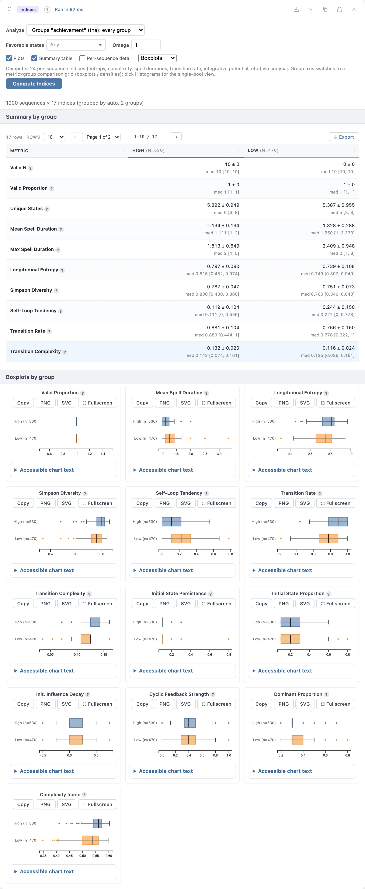</a>
<figcaption>Seventeen sequence indices for the 530 High and 470 Low sequences, summarized by group and plotted as boxplots.</figcaption>
</figure>

Sequence indices summarize each sequence by numbers. The seventeen indices
computed by default are Valid N and Valid Proportion, Unique States, Mean
and Max Spell Duration (runs of one state), Longitudinal Entropy, Simpson
Diversity, Self-Loop Tendency, Transition Rate, Transition Complexity,
Initial State Persistence, Initial State Proportion, Initial Influence
Decay, Cyclic Feedback Strength, Dominant Proportion, Dominant Max Spell and
the Complexity Index. The ? beside each index name in the table explains it.
Favorable states adds the indices that depend on which states count as
favorable.

| Control | Default | What it sets |
|---|---|---|
| Favorable states | none | States considered Options: Discuss, Plan, Practice, Read, Reflect, Review, Watch, Write. (Shown only with some settings.) |
| Omega | 1 | Time-weighting exponent for time-weighted indices. 1 = uniform weight across positions (default); &gt;1 weights later positions more; &lt;1 weights earlier positions more. |
| Plots | on | — |
| Summary table | on | — |
| Per-sequence detail | off | — |
| Plot type | Boxplots | Comparison plot type Options: Boxplots, Densities, Histograms. |
| Group axis | Auto (active) | Group axis: Auto=last-built group/clustering; Clusters=last clustering run; Column=re-derive from group column; Last observation=group by final state of each sequence. Options: Auto (active), Group column, Clusters, Last observation. |

Favorable states is a substantive choice made by the analyst; the indices
that use it are computed only when it is set. Per-sequence detail adds a
table with every index for every sequence.

## Pattern mining

### Discover patterns

<figure>
<a href="guide/cell-patterns.webp">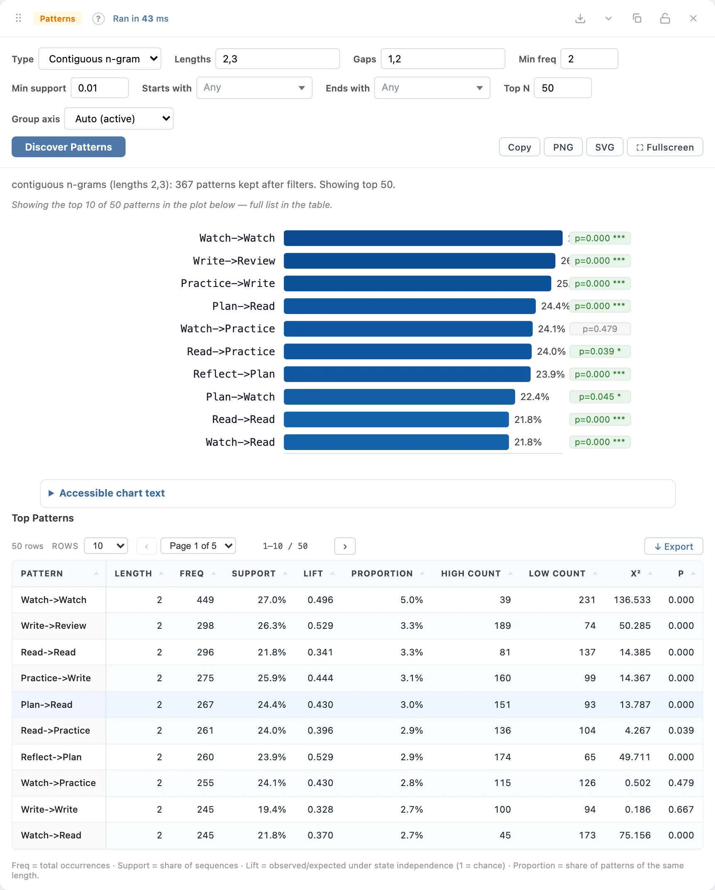</a>
<figcaption>Contiguous patterns of length 2 and 3: 367 patterns pass the filters. Watch → Watch is the most widespread, present in 27.0% of the sequences.</figcaption>
</figure>

Discover patterns finds recurring subsequences.

| Control | Default | What it sets |
|---|---|---|
| Type | Contiguous n-gram | ngram: contiguous windows (A→B→C). gapped: pairs with wildcard gaps (A→*→B). repeated: runs of a single state (A→A→A). Options: Contiguous n-gram, Gapped pair, Repeated state. |
| Lengths | 2,3 | Comma-separated window lengths (for ngram + repeated) |
| Gaps | 1,2 | Comma-separated gap sizes (for gapped — A separated from B by this many wildcard positions) |
| Min freq | 2 | Minimum total occurrences across all sequences |
| Min support | 0.01 | Minimum fraction of sequences containing the pattern (0–1) |
| Starts with | none | Keep only patterns starting with one of these states. Click to open, check states to include, leave empty for none. Options: Discuss, Plan, Practice, Read, Reflect, Review, Watch, Write. (Shown only with some settings.) |
| Ends with | none | Keep only patterns ending with one of these states. Click to open, check states to include, leave empty for none. Options: Discuss, Plan, Practice, Read, Reflect, Review, Watch, Write. (Shown only with some settings.) |
| Top N | 50 | Show at most this many patterns in the table (plot is always capped at 10) |
| Group axis | Auto (active) | Group axis: Auto=last-built group/clustering; Clusters=last clustering run; Column=re-derive from group column; Last observation=group by final state of each sequence. Options: Auto (active), Group column, Clusters, Last observation. |

Contiguous n-grams are runs of consecutive states (A → B → C). Gapped pairs
are two states separated by a fixed number of positions (A → * → B).
Repeated states are runs of one state (A → A → A). Support is the share of
sequences containing the pattern, and lift compares it with what independent
states would produce. With groups, the table adds each group's count and a
chi-square test of the difference.

### Pattern comparison (heatmap)

<figure>
<a href="guide/cell-compare.webp">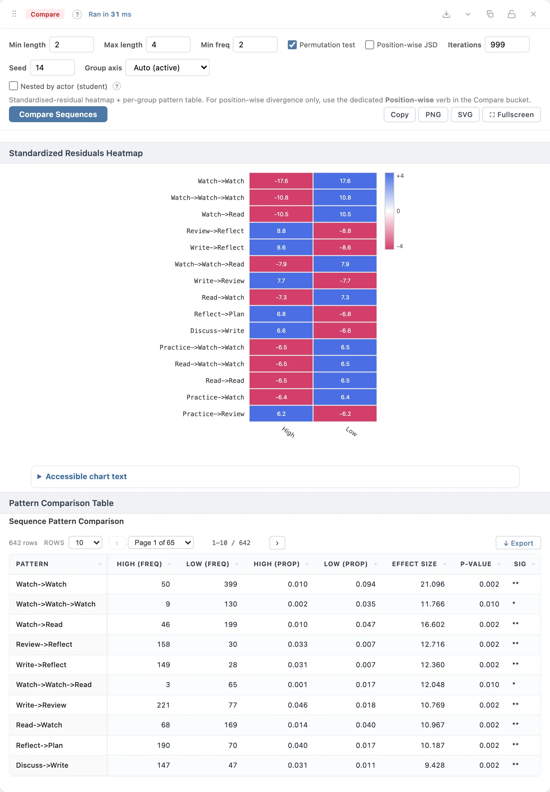</a>
<figcaption>Standardized residuals of pattern frequencies in the High and Low groups. Watch → Watch has a residual of −17.6 in High and 17.6 in Low.</figcaption>
</figure>

The heatmap compares pattern frequencies across groups. Each cell holds a
standardized residual: positive values mark patterns that are more frequent
in the group than independence predicts, negative values less frequent.

| Control | Default | What it sets |
|---|---|---|
| Min length | 2 | — |
| Max length | 4 | — |
| Min freq | 2 | — |
| Permutation test | on | — |
| Position-wise JSD | off | Position-wise Jensen-Shannon divergence between groups (which time steps differ most) |
| Iterations | 999 | — |
| Seed | 14 | Seed for reproducibility (default 14). Clear to use the engine's default seed. |
| Group axis | Auto (active) | Group axis: Auto=last-built group/clustering; Clusters=last clustering run; Column=re-derive from group column; Last observation=group by final state of each sequence. Options: Auto (active), Group column, Clusters, Last observation. |

The permutation test shuffles group labels and recomputes the residuals,
and gives each pattern a p-value. Residuals are read together with the
counts in the table, because large groups give large residuals to small
differences.

### Pattern comparison (pyramid)

<figure>
<a href="guide/cell-compare-pyramid.webp">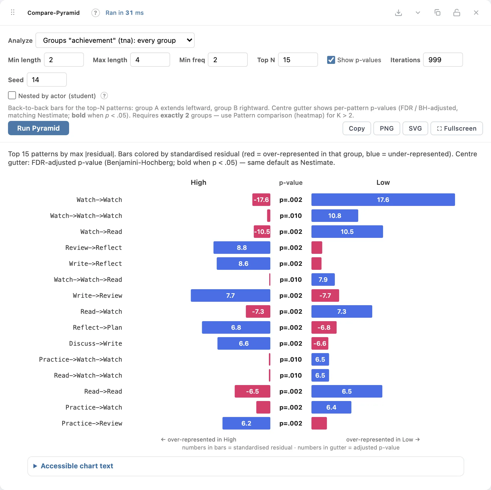</a>
<figcaption>The pyramid for High and Low: the 15 patterns with the largest residuals as back-to-back bars, with Benjamini–Hochberg adjusted permutation p-values in the centre.</figcaption>
</figure>

The pyramid shows the same comparison for exactly two groups as
back-to-back bars. Three or more groups use the heatmap.

| Control | Default | What it sets |
|---|---|---|
| Min length | 2 | — |
| Max length | 4 | — |
| Min freq | 2 | — |
| Top N | 15 | Cap on patterns shown — sorted by max \|residual\| desc |
| Show p-values | on | Permutation test per pattern (shuffles group labels, recomputes residual). Adds a centre gutter showing per-pattern p-values. |
| Iterations | 999 | Permutation iterations. Only used when Show p-values is checked. |
| Seed | 14 | Seed for reproducibility. Clear to use the engine's default seed. |
| Group axis | Auto (active) | Group axis: Auto=last-built group/clustering; Clusters=last clustering run; Column=re-derive from group column; Last observation=group by final state of each sequence. Options: Auto (active), Group column, Clusters, Last observation. |

### Pattern × outcome

<figure>
<a href="guide/cell-pattern-outcome.webp">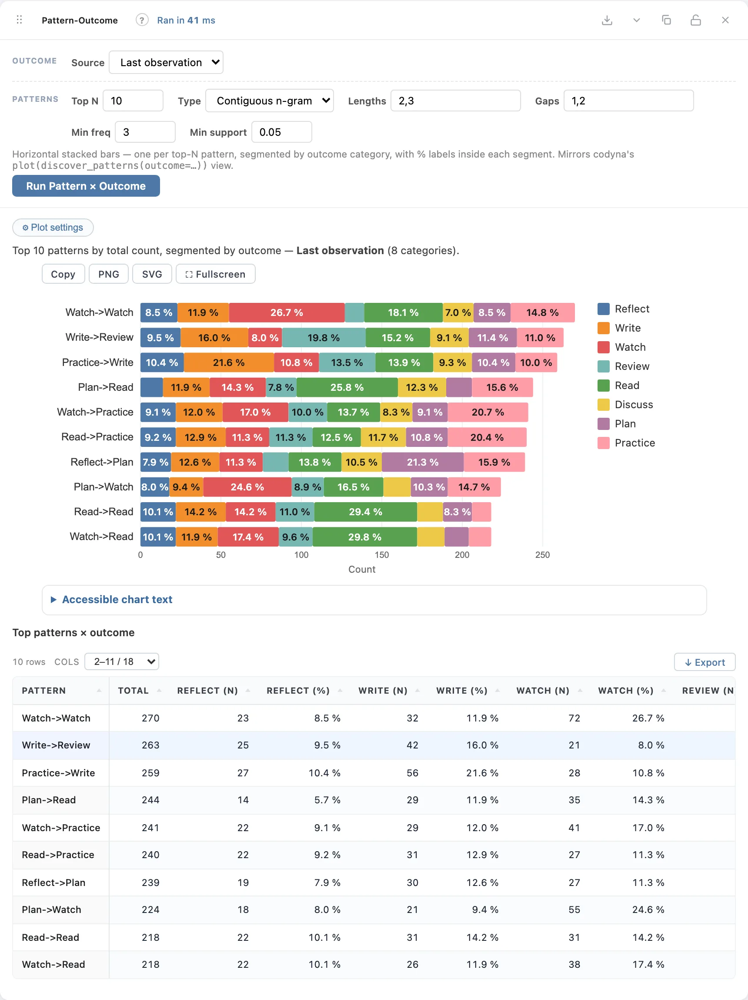</a>
<figcaption>The ten most frequent patterns, each split by the last state of the sequence (8 categories).</figcaption>
</figure>

Pattern × outcome describes how the most frequent patterns are distributed
over the categories of an outcome. Each bar is one pattern, divided by
outcome category with percentage labels. The cell is descriptive; Outcome
regression tests the associations.

| Control | Default | What it sets |
|---|---|---|
| Source | Last observation | Per-sequence outcome category. Continuous outcomes are not supported here — use Outcome regression for those. Options: Last observation, Group column, Clusters. |
| Top N | 10 | Maximum number of patterns to show in the plot (sorted by total count desc). |
| Type | Contiguous n-gram | Options: Contiguous n-gram, Gapped pair, Repeated state. |
| Lengths | 2,3 | Comma-separated lengths to consider |
| Gaps | 1,2 | Comma-separated gap sizes (gapped only) |
| Min freq | 3 | Minimum total occurrences across all sequences |
| Min support | 0.05 | Minimum support (fraction of sequences containing the pattern) |

### Outcome regression

<figure class="fig-tall">
<a href="guide/cell-outcome.webp">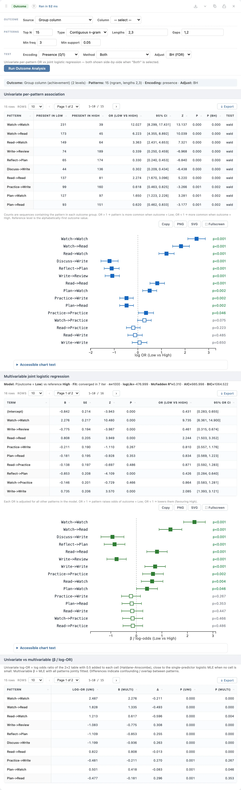</a>
<figcaption>Outcome regression with achievement as a binary outcome (reference High, target Low). The univariate table and forest plot give each pattern's odds ratio; the joint logistic regression adjusts each pattern for the others.</figcaption>
</figure>

Outcome regression tests whether patterns are associated with an outcome.

| Control | Default | What it sets |
|---|---|---|
| Source | Last observation | Vector of per-sequence outcome labels — binary outcomes use the OR + chi-square path; categorical (K&gt;2) uses 2×K chi-square with per-level OR; continuous (numeric column) triggers an OLS regression. Options: Last observation, Group column, Clusters, Numeric column (continuous). |
| Column | — select — | Used when Outcome=Numeric column. Continuous outcome triggers an OLS regression path (β, SE, t, p, R²). Options: student, session, timestamp, action, achievement. |
| Top N | 15 | Maximum number of patterns to test (more = more multiple-comparison correction) |
| Type | Contiguous n-gram | Options: Contiguous n-gram, Gapped pair, Repeated state. |
| Lengths | 2,3 | Comma-separated lengths to consider |
| Gaps | 1,2 | Comma-separated gap sizes (gapped only) |
| Min freq | 3 | Minimum total occurrences across all sequences |
| Min support | 0.05 | Minimum support (fraction of sequences containing the pattern) |
| Encoding | Presence (0/1) | Presence = each pattern's predictor is 0/1; Frequency = count of pattern occurrences per sequence (only affects multivariable mode). Options: Presence (0/1), Frequency (count). |
| Method | Both | Method: univariate runs one test per pattern (closed-form OR/χ²/Fisher). Multivariable fits a single logistic regression with all patterns as joint predictors (mirrors Dynalytics). Options: Both, Univariate (per pattern), Multivariable (joint logistic). |
| Adjust | BH (FDR) | Family-wise (Holm) or false-discovery (BH) correction across the top-N tests Options: BH (FDR), Holm, None. |

The outcome type determines the model. With two levels, the univariate
analysis gives each pattern's odds ratio from its 2×2 table of presence by
outcome, and the multivariable analysis fits one logistic regression with all
patterns as joint predictors. With more than two levels, the univariate
analysis uses a chi-square test and one-versus-rest odds ratios, and the
multivariable model is not defined. A numeric column fits a linear
regression.

The reference level is the alphabetically first value, so the odds ratios
compare the other level with it. Odds ratios above one mark patterns more
common in the target level. Multiple testing is controlled by Adjust. The
same data select the patterns and test them, which favours significant
results; a confirmatory analysis selects patterns on one part of the data
and tests them on another.

## Compare

The Compare cells need at least two networks, from Groups, Cluster
sequences or Mixture Markov model.

### Network properties

<figure class="fig-tall">
<a href="guide/cell-compare-props.webp">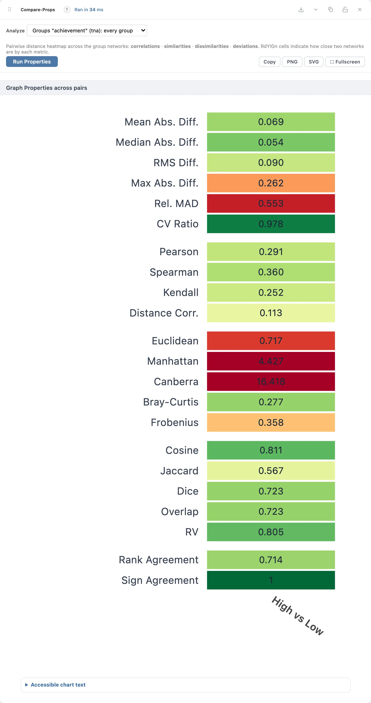</a>
<figcaption>Distances and similarities between the High and Low networks. The edge weights correlate at 0.291 (Pearson) and the cosine similarity is 0.811.</figcaption>
</figure>

Network properties compares whole networks with summary measures of the
differences between their edge weights (mean, median, root-mean-square and
maximum absolute differences), correlations, distances and similarities.

| Control | Default | What it sets |
|---|---|---|
| Group axis | Auto (active) | Group axis: Auto=last-built group/clustering; Clusters=last clustering run; Column=re-derive from group column; Last observation=group by final state of each sequence. Options: Auto (active), Group column, Clusters, Last observation. |

### Difference network

<figure class="fig-tall">
<a href="guide/cell-compare-diff.webp">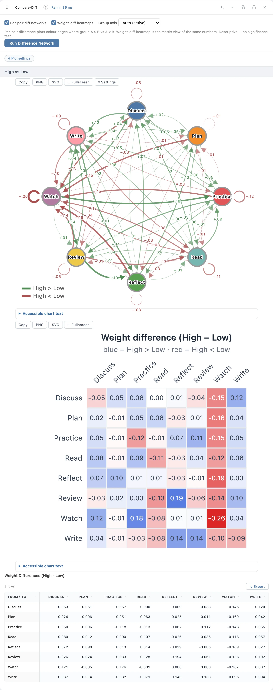</a>
<figcaption>The difference network and the heatmap of weight differences (High − Low). Green edges are stronger in High and red edges in Low.</figcaption>
</figure>

The difference network subtracts one group's weights from another's and
plots the result. The cell is descriptive; it shows where networks differ
and leaves the question of whether the differences exceed chance to the
permutation test.

| Control | Default | What it sets |
|---|---|---|
| Per-pair diff networks | on | — |
| Weight-diff heatmaps | on | — |
| Group axis | Auto (active) | Group axis: Auto=last-built group/clustering; Clusters=last clustering run; Column=re-derive from group column; Last observation=group by final state of each sequence. Options: Auto (active), Group column, Clusters, Last observation. |

### Permutation test

<figure class="fig-tall">
<a href="guide/cell-compare-perm.webp">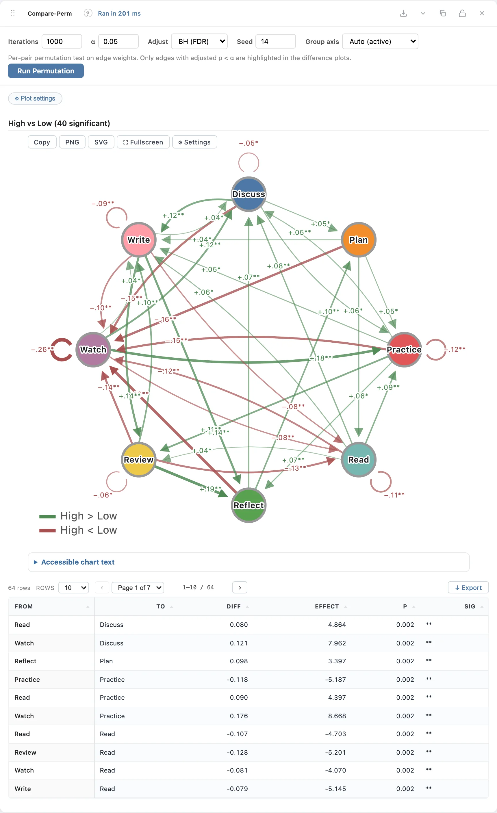</a>
<figcaption>The permutation test for High and Low with 1,000 permutations and Benjamini–Hochberg adjustment: 40 edges differ significantly.</figcaption>
</figure>

The permutation test shuffles group membership among the sequences many
times and compares the observed edge differences with the shuffled ones.
Each edge receives a p-value, adjusted for the number of edges tested.

| Control | Default | What it sets |
|---|---|---|
| Iterations | 1000 | Permutation iterations |
| α | 0.05 | Significance threshold for permutation p-values |
| Adjust | BH (FDR) | Multiple-comparison correction Options: BH (FDR), Holm, Bonferroni, FDR, None. |
| Seed | 14 | Seed for reproducibility (default 14) |
| Group axis | Auto (active) | Group axis: Auto=last-built group/clustering; Clusters=last clustering run; Column=re-derive from group column; Last observation=group by final state of each sequence. Options: Auto (active), Group column, Clusters, Last observation. |

The test assumes that sequences are exchangeable between groups under the
null hypothesis. When one actor contributes several sequences, those
sequences are not independent, and the p-values are interpreted with that in
mind.

### Position-wise JSD

<figure>
<a href="guide/cell-compare-pos.webp">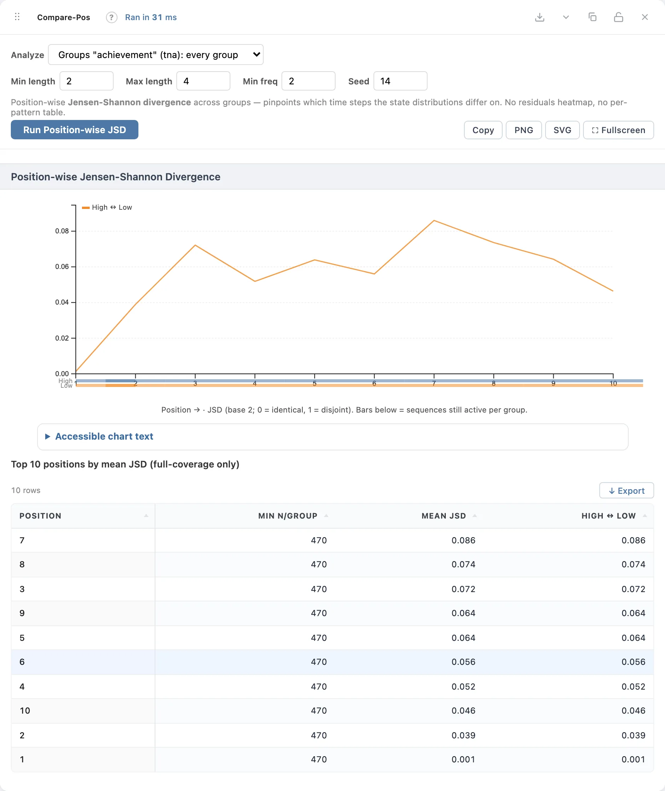</a>
<figcaption>The Jensen–Shannon divergence between the High and Low state distributions at each position, with the positions of largest divergence listed below.</figcaption>
</figure>

Position-wise JSD compares the groups' state distributions at each position
of the sequences. The Jensen–Shannon divergence is 0 for identical
distributions and 1 for disjoint ones. The comparison assumes that positions
have the same meaning across sequences.

| Control | Default | What it sets |
|---|---|---|
| Min length | 2 | Pattern lengths used to compute per-position state distributions |
| Max length | 4 | — |
| Min freq | 2 | — |
| Seed | 14 | Seed for reproducibility (default 14) |
| Group axis | Auto (active) | Group axis: Auto=last-built group/clustering; Clusters=last clustering run; Column=re-derive from group column; Last observation=group by final state of each sequence. Options: Auto (active), Group column, Clusters, Last observation. |

## Process mining

The Process mining cell reads the sequences as an event log: each sequence is
a case, each state an activity, and each transition a hand-off. Its Method
selector switches between a process map and directly-follows tables.

### Process map

<figure class="fig-tall">
<a href="guide/cell-process-mining-process-map.webp">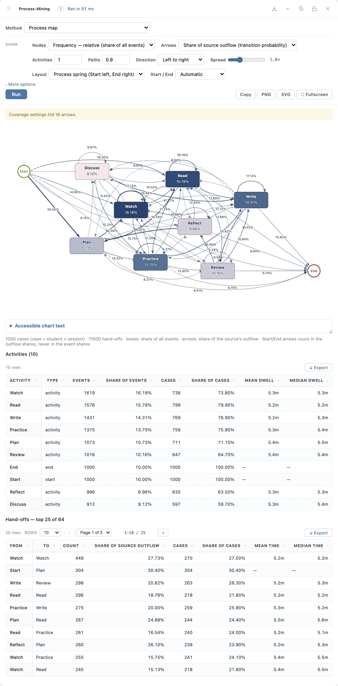</a>
<figcaption>The process map of the sample data. Boxes are activities with their share of all events; arrows are hand-offs with the share of the source activity's outflow. The note above the map states that the coverage settings hid 16 arrows.</figcaption>
</figure>

| Control | Default | What it sets |
|---|---|---|
| Nodes | Frequency — relative (share of all events) | What each activity box reports (bupaR type_nodes).; Frequency — event counts, absolute or as a share of all events; Cases — how many cases visit the activity; Duration — dwell time inside the activity (needs a Time column) Options: Frequency — absolute, Frequency — relative (share of all events), Cases — absolute, Cases — relative (share of cases), Duration — mean, Duration — median, Duration — min, Duration — max, Duration — total. |
| Arrows | Share of source outflow (transition probability) | What each arrow reports (bupaR type_edges).; Frequency — how often the hand-off occurs; Cases — how many cases contain it; Transition probability — share of the source activity’s outgoing flow; Duration — transit time between the two activities Options: Frequency — absolute, Cases — absolute, Cases — relative (share of cases), Share of source outflow (transition probability), Share of target inflow, Duration — mean, Duration — median, Duration — min, Duration — max, Duration — total. |
| Activities | 1 | Coverage of events, as in bupaR filter_activity_frequency(): keep the most frequent activities that together account for this share of ALL events. Lower it to drop activities from the map entirely. 1 = keep everything. |
| Paths | 0.9 | Coverage of hand-offs: keep the heaviest arrows that together account for this share of ALL transitions. 0.8 keeps the arrows carrying 80% of the traffic — usually far fewer than 80% of the arrows. 1 = the complete map. |
| Direction | Left to right | Flow direction of the map. Options: Left to right, Top to bottom. |
| Spread | 1 | Pull the map together or spread it apart. Applies to both the flow layout (rank and node spacing) and the borrowed network layouts (overall scale). |
| Layout | Process spring (Start left, End right) | Process map places activities in flow order. The other layouts are the notebook’s own network layouts, applied to the same map — useful when the flow reading matters less than structure. |
| Start / End | Automatic | Where Start and End are drawn on the process spring.; Automatic — diagonal when the map has height, left and right when it is a flat ribbon; Left and right — on the middle line, outside the activities; Diagonal — Start top-left, End bottom-right, the map reads like a page; Top and bottom — the flow runs down the page, Start above, End below |
| Nodes | (none) | Optional second value shown in brackets on each activity (bupaR sec_nodes). Options: (none), Frequency — absolute, Frequency — relative (share of all events), Cases — absolute, Cases — relative (share of cases), Duration — mean, Duration — median, Duration — min, Duration — max, Duration — total. |
| Arrows | (none) | Optional second value shown under each arrow label (bupaR sec_edges). Left as (none) on a timestamped map, arrows still show mean duration as a second line. Options: (none), Frequency — absolute, Cases — absolute, Cases — relative (share of cases), Share of source outflow (transition probability), Share of target inflow, Duration — mean, Duration — median, Duration — min, Duration — max, Duration — total. |
| Time units | Auto | Unit durations are reported in. Auto picks a readable unit per value. Options: Auto, Seconds, Minutes, Hours, Days, Weeks. |
| Min hand-offs | 0 | Hide hand-offs observed fewer than this many times. Often the clearest way to cut a dense map, and the easiest to report. |
| Top edges | 25 | Rows in the hand-off table below the map. |
| Wrap rows | Auto | Fold a wide map into several rows. Auto folds only when the map is genuinely wide. Layout only — nothing is hidden. Options: Auto, Off — one row, 4 per row, 6 per row, 8 per row, 10 per row. |
| Edge labels | Auto | Arrow labels on a dense map. Auto labels everything on a small map but only the strongest arrows once the map passes 60. Options: Auto, All, None. |
| Start / End nodes | on | Add synthetic Start and End nodes around every case. |
| Self-loops | on | Draw arcs for activities that immediately repeat. |
| Activity table | on | Show the per-activity table underneath the map. |
| Hand-off table | on | Show the per-hand-off table underneath the map. |

The measures follow the vocabulary of the R package bupaR. Frequency counts
events, Cases counts the cases that contain the activity or hand-off, and
Duration measures the time spent in an activity or between two activities.
An activity repeated within a case counts once under Cases and several times
under Frequency. Durations need a Time column.

The Activities and Paths controls simplify the map. Activities keeps the most
frequent activities that together cover the given share of all events.
Paths keeps the heaviest arrows that together cover the given share of all
hand-offs; the default of 0.9 keeps the arrows that carry 90% of the
traffic. These settings change only the drawing: every reported measure is
computed on the full log, and the note above the map states what was hidden.

### Directly-follows graph

<figure>
<a href="guide/cell-process-mining-dfg.webp">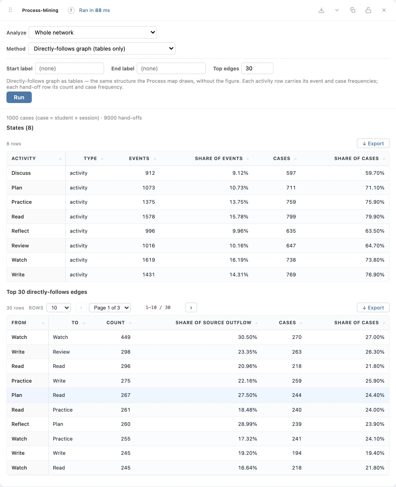</a>
<figcaption>The directly-follows tables: 1,000 cases (student × session) with 9,000 hand-offs. Watch is the most frequent activity with 1,619 events.</figcaption>
</figure>

The directly-follows graph gives the same structure as tables, with event
and case counts for every activity and every hand-off.

| Control | Default | What it sets |
|---|---|---|
| Start label | empty ((none)) | Optional start-state label to inject as the first state of every sequence |
| End label | empty ((none)) | Optional end-state label to append to every sequence |
| Top edges | 30 | Number of top edges (by frequency) to show in the edge table |

## High-order

The High-order cell holds eight methods behind one Method selector. They go
beyond the first-order transition network in two directions. Higher-order
paths and memory networks ask whether the next state depends on the states
before the current one. Simplicial complexes and hypergraphs represent
interactions among groups of states.

### Simplicial complex (pattern motifs)

<figure class="fig-tall">
<a href="guide/cell-high-order-simplicial.webp">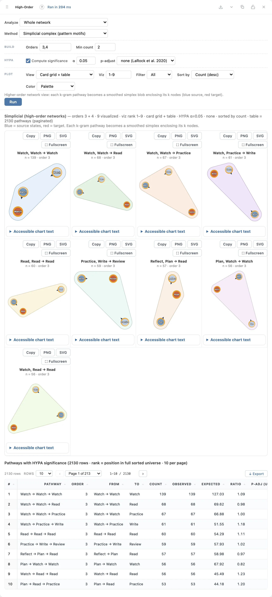</a>
<figcaption>Pattern motifs of orders 3 and 4: the nine most frequent pathways drawn as simplices, above a table of 2,130 pathways with HYPA statistics.</figcaption>
</figure>

This method counts the pathways of k states and draws each as a smoothed
shape enclosing its states, with the source states in blue and the target in
red. With Compute significance, each pathway is tested with HYPA (below).

| Control | Default | What it sets |
|---|---|---|
| Orders | 3,4 | K-gram order(s). Comma list (3,4,5) or range (3-6). Mixed orders are pooled in one ranked list. |
| Min count | 2 | Drop pathways with count below this. Default = 2 keeps signal and skips noise; set to 1 to keep every pathway, including singletons. |
| Compute significance | on | Compute HYPA per order. Adds Observed/Expected/Ratio/p-adj/Anomaly columns; in visualizations, anomalous blobs get stronger outlines (and semantic colors when Color = HYPA anomaly). |
| α | 0.05 | HYPA significance threshold (α) |
| p-adjust | none (LaRock et al. 2020) | Multiple-comparison correction applied per order across all tested k-grams. Options: none (LaRock et al. 2020), BH, Bonferroni, Holm. |
| View | Card grid + table | Card grid = small SVG per pathway. Combined = one overlay SVG. Table only = no visualization. Pathway table is always shown (paginated). Options: Card grid + table, Panel grid (one image), Combined overlay + table, Table only. |
| Viz | 1-9 | Pathways shown in the visualization. Accepts a single number (top N) or a range (e.g. 6-12 = the 6th through 12th by current sort). |
| Filter | All | Filter both the VISUALIZATION and the TABLE by HYPA anomaly class.; All — every pathway (no filter); Under — significantly LESS frequent than chance; Over — significantly MORE frequent than chance Under / Over require HYPA enabled; if HYPA is off the filter is auto-enabled. |
| Sort by | Count (desc) | Sort order for both the visualization (largest-first behind smaller blobs) and the table.; Count — descending count; HYPA p-adj — smallest adjusted p first (most surprising); Anomaly — over / under / normal grouped Options: Count (desc), HYPA p-adj, Anomaly type, Order then count. |
| Color | Palette | Blob colors:; Palette — distinct hue per pathway (default); HYPA anomaly — red = over, blue = under, gray = normal (semantic) |

### Homology: Betti numbers, Euler characteristic and q-analysis

<figure class="fig-tall">
<a href="guide/cell-high-order-homology.webp">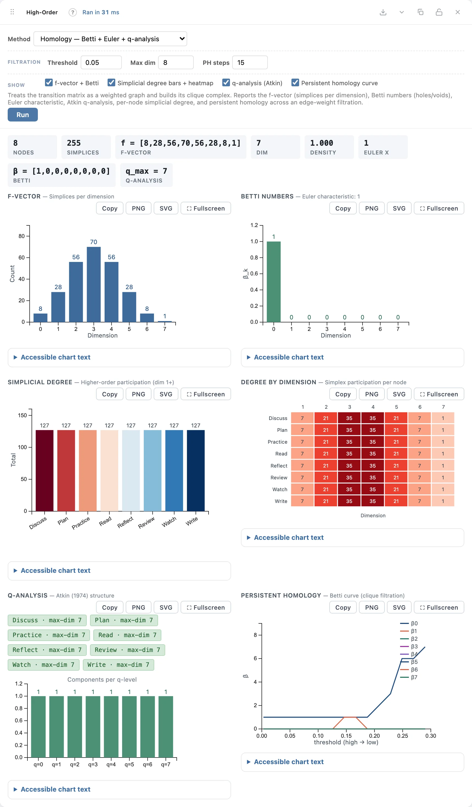</a>
<figcaption>Homology of the sample network at a threshold of 0.05: all 8 states form one clique, so the complex is a single 7-dimensional simplex with f-vector [8, 28, 56, 70, 56, 28, 8, 1], Betti numbers [1, 0, …] and Euler characteristic 1.</figcaption>
</figure>

Homology treats the thresholded network as a clique complex, in which every
clique of states is filled in as a simplex, and describes its shape. The
f-vector counts simplices by dimension, Betti numbers count connected
components (β₀), loops (β₁) and higher-dimensional holes, and the Euler
characteristic combines them. Atkin's q-analysis describes how states are
connected through shared faces, and the persistent-homology curve shows how
the Betti numbers change as the threshold rises.

| Control | Default | What it sets |
|---|---|---|
| Threshold | 0.05 | Drop edges with weight below this threshold before building the clique complex. For TNA probability matrices most entries are &gt;0, so threshold=0 yields a near-complete graph and meaningless topology — use 0.05–0.10 (or pre-prune the network). |
| Max dim | 8 | Cap on simplex dimension. The complex stops growing automatically when no more cliques exist at the next dimension, so high values are safe for typical TNA networks (≤ 30 states). Lower only if you need to truncate intentionally. |
| PH steps | 15 | Number of filtration steps for the persistent-homology Betti curve |
| f-vector + Betti | on | — |
| Simplicial degree bars + heatmap | on | — |
| q-analysis (Atkin) | on | — |
| Persistent homology curve | on | — |

A probability network is often nearly complete at low thresholds, as here,
and then its topology is trivial. The threshold is varied before any
topological feature is interpreted.

### Hypergraph centrality

<figure>
<a href="guide/cell-high-order-hyper-cent.webp">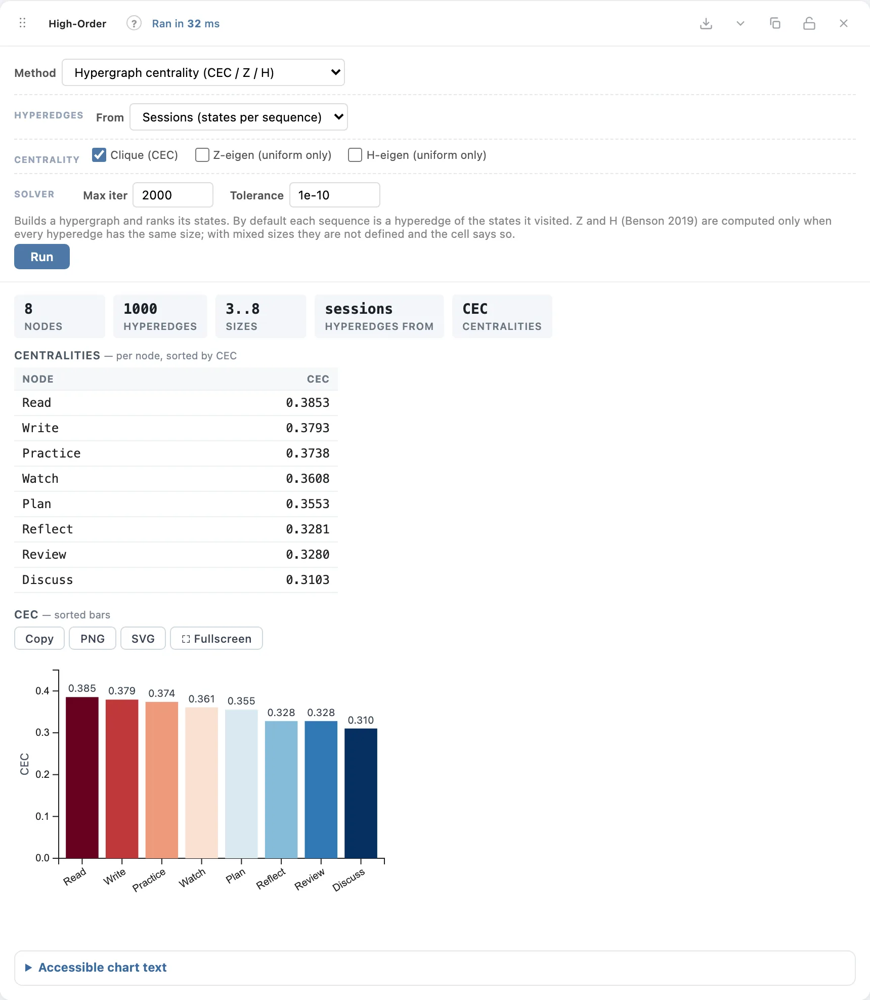</a>
<figcaption>Hypergraph centrality from sessions: 1,000 hyperedges of 3 to 8 states. Read has the highest clique-expansion eigenvector centrality (0.3853).</figcaption>
</figure>

A hypergraph connects any number of states with one hyperedge. By default
each sequence is a hyperedge holding the set of states it visited, a group
interaction that is observed in the data. The alternative builds hyperedges
from cliques of the thresholded network, which are fully determined by its
pairwise links.

| Control | Default | What it sets |
|---|---|---|
| From | Sessions (states per sequence) | Sessions: each sequence is one hyperedge holding the set of states it visited, a group interaction observed in the data. Network cliques: cliques of the thresholded transition network, which are fully determined by its pairwise links and do not show that a group interaction occurred. Options: Sessions (states per sequence), Network cliques. |
| Threshold | 0.05 | Drop edges with weight below this threshold before extracting cliques as hyperedges. For TNA probability matrices most entries are &gt;0, so threshold=0 yields a near-complete hypergraph — use 0.05–0.10 (or pre-prune the network). (Shown only with some settings.) |
| Max size | 8 | Maximum hyperedge size. Hyperedges are cliques of size 2..maxSize. (Shown only with some settings.) |
| Clique (CEC) | on | Eigenvector centrality of the clique expansion (two states linked by the number of hyperedges holding both); defined for hyperedges of any size |
| Z-eigen (uniform only) | off | Z-eigenvector of the hypergraph adjacency tensor (Benson 2019). Defined only when every hyperedge has the same size. |
| H-eigen (uniform only) | off | H-eigenvector of the hypergraph adjacency tensor (Benson 2019). Defined only when every hyperedge has the same size. |
| Max iter | 2000 | Max iterations of the Z/H tensor iteration (the clique centrality is solved directly) |
| Tolerance | 1e-10 | Convergence tolerance of the Z/H iteration |

The clique-expansion eigenvector centrality (CEC) is defined for hyperedges
of any size. The Z- and H-eigenvector centralities of Benson (2019) are
defined only when every hyperedge has the same size; with mixed sizes the
cell says so and computes CEC only.

### HYPA: path anomaly

<figure class="fig-tall">
<a href="guide/cell-high-order-hypa.webp">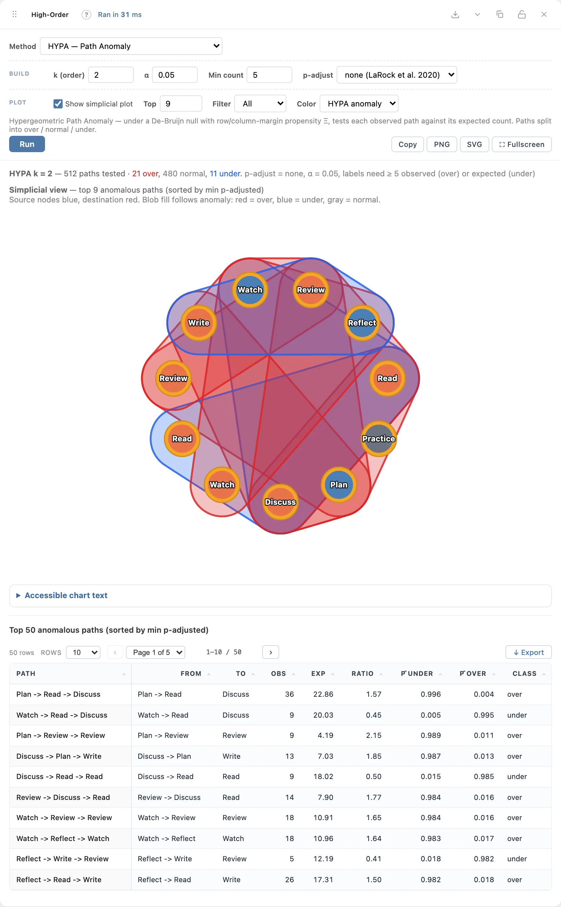</a>
<figcaption>HYPA at k = 2: of 512 paths tested, 21 are over-represented, 11 under-represented and 480 within expectation.</figcaption>
</figure>

HYPA (LaRock et al., 2020) asks whether a path of length k occurs more or
less often than expected from the transitions of the order below it. The
expected counts come from a hypergeometric null model on the De Bruijn graph
of order k. A path is over-represented when it is observed more often than
the null model predicts and under-represented when it is observed less often.

| Control | Default | What it sets |
|---|---|---|
| k (order) | 2 | Order of the De-Bruijn graph (k=2 → pair paths; k=3 → triplet paths) |
| α | 0.05 | Significance threshold for two-sided anomaly classification |
| Min count | 5 | A path is labelled over-represented only if observed at least this often, under-represented only if expected at least this often. Every path is still scored and adjusted. LaRock et al. (2020) use no floor (1). |
| p-adjust | none (LaRock et al. 2020) | Multiple-comparison correction across all tested paths Options: none (LaRock et al. 2020), Benjamini-Hochberg, Bonferroni, Holm. |
| Show simplicial plot | on | Render each top anomalous path as a smoothed simplex blob over its k+1 states. Same visual as the Simplicial verb. |
| Top | 9 | Number of top anomalous paths (smallest min-p-adj first) to render as simplices |
| Filter | All | Filter the plot by HYPA anomaly:; All — every top path; Under — significantly less than chance; Over — significantly more than chance |
| Color | HYPA anomaly | Blob fill:; Palette — distinct hue per path; HYPA anomaly — red over / blue under / gray normal |

The default applies no adjustment for multiple testing, as in LaRock et al.
(2020); p-adjust applies one. Min count only labels paths: a path is called
over-represented only when it was observed at least that often, and
under-represented only when it was expected at least that often.

### MOGen: order selection

<figure>
<a href="guide/cell-high-order-mogen.webp">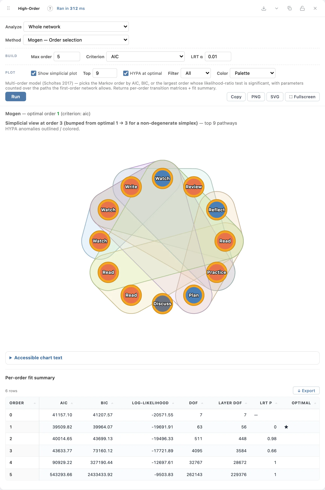</a>
<figcaption>MOGen selects order 1 by AIC. The per-order table gives AIC, BIC, log-likelihood and degrees of freedom for orders 0 to 5.</figcaption>
</figure>

MOGen fits multi-order models (Scholtes, 2017) up to Max order and selects
the order by AIC, BIC or sequential likelihood-ratio tests. The three
criteria answer related but different questions and can select different
orders.

| Control | Default | What it sets |
|---|---|---|
| Max order | 5 | Highest Markov order to consider when selecting the optimal one |
| Criterion | AIC | Criterion used to pick the optimal order Options: AIC, BIC, LRT (largest significant order). |
| LRT α | 0.01 | Significance level used by LRT criterion (ignored for AIC / BIC) |
| Show simplicial plot | on | Render the top pathways AT THE SELECTED OPTIMAL ORDER as smoothed simplex blobs. Each simplex spans (optimal-order + 1) states. |
| Top | 9 | Number of top k-grams at the optimal order to render as simplices |
| HYPA at optimal | on | Run HYPA at the optimal order so the simplicial plot can color/outline by anomaly. |
| Filter | All | Filter the plot by HYPA anomaly:; All — every top pathway; Under — significantly less than chance; Over — significantly more than chance |
| Color | Palette | Blob fill:; Palette — distinct hue per pathway; HYPA anomaly — red over / blue under / gray normal |

### HON: higher-order network

<figure class="fig-tall">
<a href="guide/cell-high-order-hon.webp">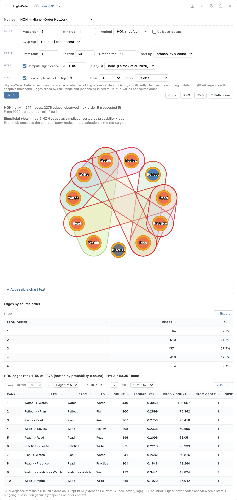</a>
<figcaption>A higher-order network (HON+) with 577 nodes and 2,376 edges; histories of up to five states are kept where they change the next-state distribution.</figcaption>
</figure>

A higher-order network (Xu, Wickramarathne and Chawla, 2016) splits a state
into several nodes that carry different histories when the history changes
where the process goes next. HON+ (Saebi, Xu et al., 2020) finds the order
of each dependency itself up to Max order.

| Control | Default | What it sets |
|---|---|---|
| Max order | 5 | Longest history a node may carry. HON+ finds the order of each dependency itself, up to this cap (the reference pyHON uses 99). |
| Min freq | 1 | Drop tuples with raw count below this threshold |
| Method | HON+ (default) | HON+ (Saebi et al. 2020): builds higher orders lazily with a MaxDivergence pre-check. HON: classical Xu et al. 2016 Options: HON+ (default), HON (classical). |
| Collapse repeats | off | Collapse runs of the same state into one (A,A,A→A). The reference pyHON always collapses repeats; leaving them in keeps self-transitions, which carry meaning in TNA data. |
| From rank | 1 | Show edges ranked from this position (1-based, sorted by probability × count desc) |
| To rank | 50 | Show edges through this rank (inclusive). E.g. From 1 To 50 = top 50. |
| Order filter | empty (all) | Restrict the edge table to specific source orders (blank = all). Accepts 2, 2-4, 2,3. |
| Sort by | probability × count | Sort the edge table by this column (descending) Options: probability × count, count, probability, from order. |
| Compute significance | on | Run HYPA per source-order group and join its p-values to each HON edge. Adds Observed / Expected / p-adj / Anomaly columns to the edge table. |
| α | 0.05 | HYPA significance threshold |
| p-adjust | none (LaRock et al. 2020) | Multiple-comparison correction Options: none (LaRock et al. 2020), Benjamini-Hochberg, Bonferroni, Holm. |
| Show simplicial plot | on | Render each top HON edge as a smoothed simplex blob (k-history nodes on a layout circle, blob encloses them with the destination as the target). Same visual as the Simplicial verb. |
| Top | 9 | Number of top HON edges (from the current sort) to render as simplices |
| Filter | All | Filter the plot (and only the plot) by HYPA anomaly:; All — every top edge; Under — significantly less than chance; Over — significantly more than chance |
| Color | Palette | Blob fill:; Palette — distinct hue per edge; HYPA anomaly — red over / blue under / gray normal |

The nodes of a higher-order network represent histories, for example
"Watch after Read", and not new states. The reference implementation always
collapses repeated states; the notebook keeps them by default because
repetition carries meaning in TNA data.

### HONEM: HON embeddings

<figure>
<a href="guide/cell-high-order-honem.webp">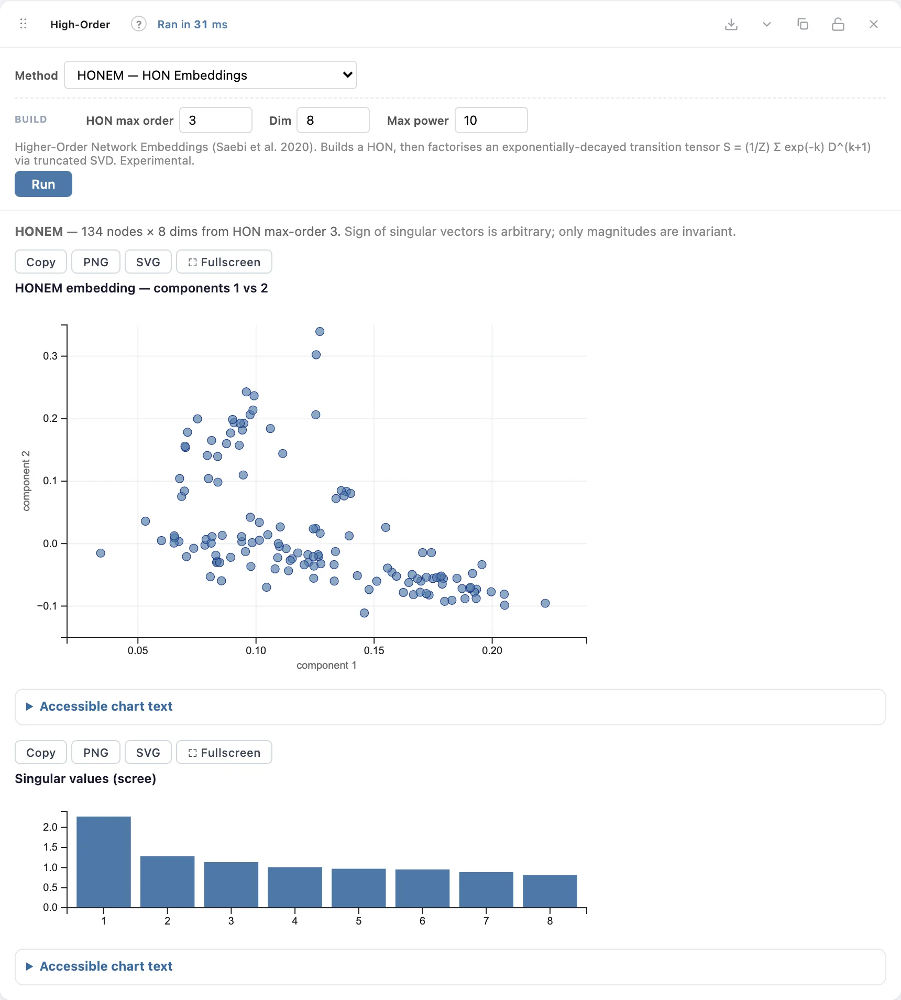</a>
<figcaption>HONEM embeddings: 134 higher-order nodes in 8 dimensions from a HON of maximum order 3, plotted on the first two components with the singular values below.</figcaption>
</figure>

HONEM (Saebi, Ciampaglia et al., 2020) embeds the nodes of a higher-order network in a
low-dimensional space from an exponentially weighted sum of powers of its
transition matrix. The signs of the components are arbitrary. The method is
experimental.

| Control | Default | What it sets |
|---|---|---|
| HON max order | 3 | Max order of the HON the embeddings are computed on |
| Dim | 8 | Embedding dimensions (top singular components retained) |
| Max power | 10 | Highest power of D included in S = (1/Z) Σ exp(-k) D^(k+1) |

### Path dependence

<figure>
<a href="guide/cell-high-order-path-dep.webp">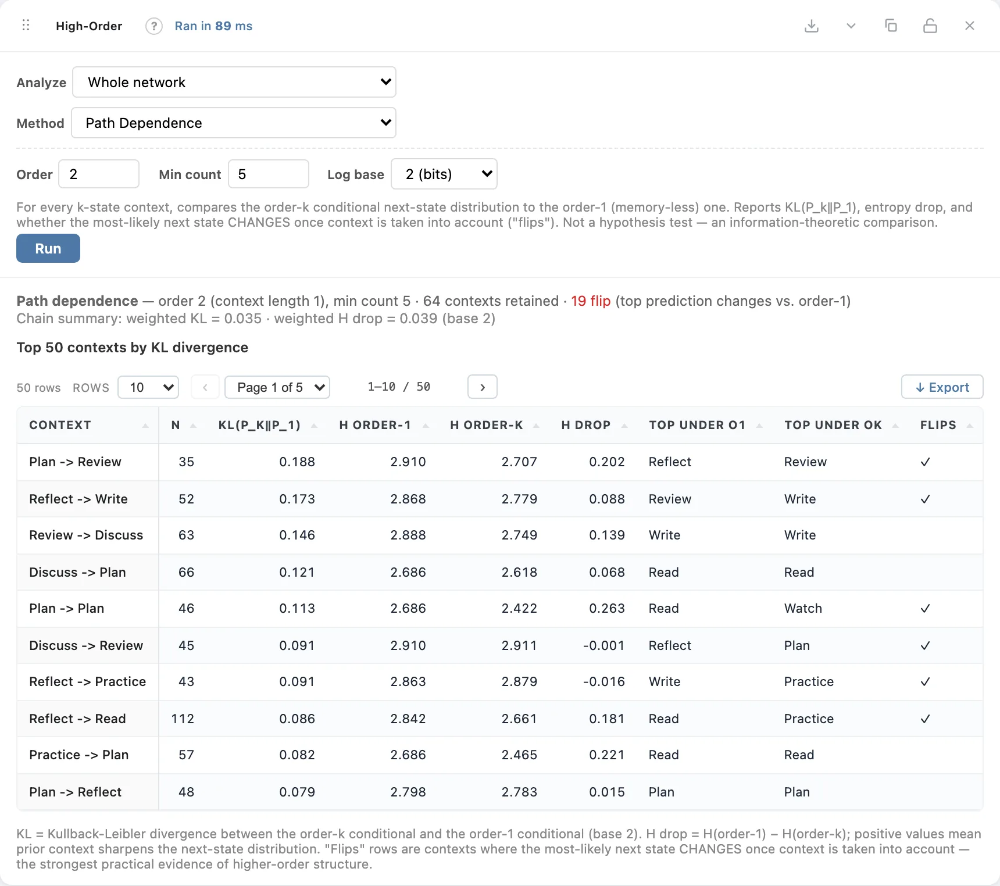</a>
<figcaption>Path dependence at order 2: 64 contexts with at least 5 occurrences, of which 19 change the most likely next state compared with the first-order model.</figcaption>
</figure>

Path dependence compares the next-state distribution after each context
(the current state and the states before it) with the first-order
distribution. It reports the Kullback–Leibler divergence, the change in
entropy, and whether the most likely next state changes ("flips"). It is an
information-theoretic description and not a test.

| Control | Default | What it sets |
|---|---|---|
| Order | 2 | Markov order to test. Order 2 conditions on 1 previous state, order 3 on 2 previous states, etc. (Library default = 2.) |
| Min count | 5 | Drop contexts seen fewer than this many times — smaller counts give unstable conditional distributions. |
| Log base | 2 (bits) | Logarithm base for the entropy and KL columns. 2 = bits (default); e = nats; 10 = decit. Options: 2 (bits), e (nats), 10 (decit). |

## Note

<figure>
<a href="guide/cell-text.webp"></a>
<figcaption>A Note cell with a title and formatted text between analysis cells.</figcaption>
</figure>

The Note cell holds formatted text: headings, paragraphs, lists, quotations,
tables, images and inline formatting. Notes record the research question,
the decisions taken and the interpretation next to the results they refer
to, and they are included in the saved notebook and in the exports.

## Saving, opening and sharing

<figure>
<a href="guide/08-file-menu.webp"></a>
<figcaption>The File menu.</figcaption>
</figure>

### Save and the notebook library

Save, or Ctrl+S and Cmd+S, downloads the notebook as one `.html` file named
after the notebook title. The file contains the data, the mapping, every
cell with its settings and results, and the notebook itself, so it opens on
any computer with a browser and can be archived or shared as it is.

The notebook also saves itself to the browser's storage while it is open.
File → Open Notebook… lists the notebooks stored in this browser, where they
can be opened, renamed or deleted. Browser storage belongs to one browser on
one computer and is cleared with the browser's site data, so the downloaded
file is the copy that is kept.

<figure>
<a href="guide/14-open-notebook.webp">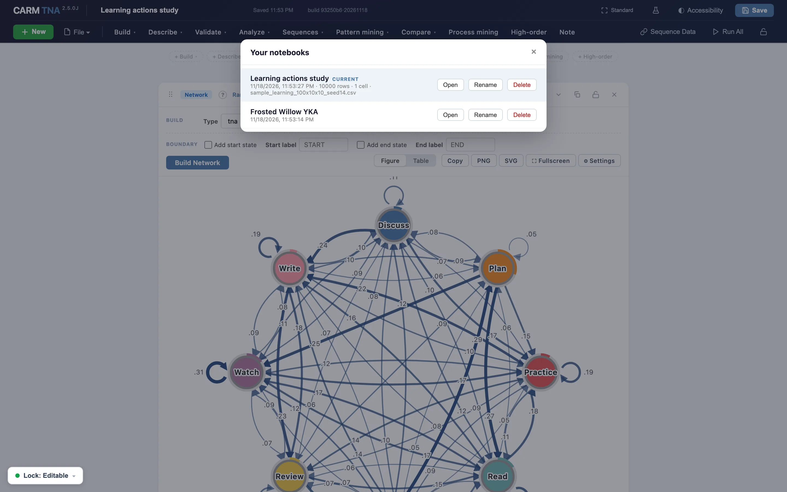</a>
<figcaption>The notebook library lists the notebooks stored in this browser.</figcaption>
</figure>

| File command | Effect |
|---|---|
| New Notebook | Starts a blank notebook. |
| Open Notebook… | Opens the library of notebooks stored in this browser. |
| Load Data… | Opens a CSV or TSV file. |
| Generate sample data… | Opens the sample-data dialog. |
| Save As… | Stores a copy under a new name in the browser library. Save still produces the file. |
| Publish | Switches the notebook to a read-only report view: every cell is locked with its current result and the editing controls are hidden. The bar at the top offers Edit, which returns to editing and clears the cached results, and Duplicate to editable copy. |
| Copy All | Copies the notebook's results for pasting into a document. |
| Word (.doc) | Downloads a Word document with the notes and results. |
| HTML Report | Downloads a report of the results as a web page; the report is not an editable notebook. |
| Print / PDF | Opens the browser's print dialog, which can save a PDF. |
| Clear data & cells | Removes the data, the model and the cells from the current notebook. |
| Delete notebook… | Deletes the current notebook from the browser library; saved files are unaffected. |
| Privacy & network access | States what the notebook stores and that it makes no network requests for analysis. |
| Reset notebook storage & reload… | Clears this notebook's browser library and reloads. Saved files are unaffected. |
| Clear browser analysis history… | Clears all Carm data stored by this browser, including notebooks and preferences. |

### Locking and sealing

<figure>
<a href="guide/13-lock-menu.webp">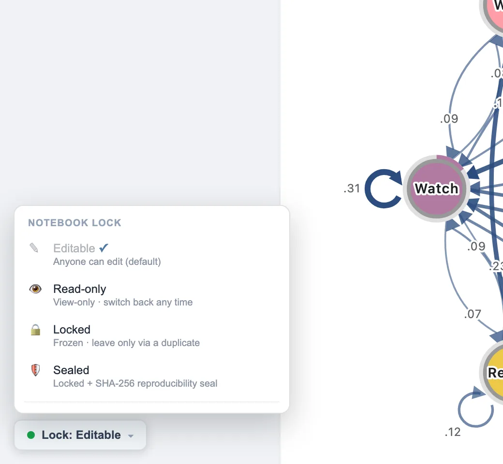</a>
<figcaption>The notebook lock menu in the lower-left corner.</figcaption>
</figure>

The lock menu sets the sharing state of the whole notebook.

| State | Meaning |
|---|---|
| Editable | The default. Everything can be changed. |
| Read-only | A viewing state; it can be switched back to editable at any time. |
| Locked | A frozen notebook. It can only be left by Duplicate to editable copy, which keeps the original intact. |
| Sealed | A locked notebook with a SHA-256 fingerprint over its content. A notebook whose content no longer matches its seal shows a warning when it opens. Copy fingerprint copies the seal for recording elsewhere. |

The state is chosen first and the notebook saved afterwards, so that the
downloaded file carries it. An editable copy is saved before a notebook is
locked or sealed.

## About, license and citation

<figure>
<a href="guide/15-about.webp"></a>
<figcaption>The About window, opened from the footer.</figcaption>
</figure>

About, License and How to cite in the footer open a window with the
description of the software, the Carm Research License, the citation text
and BibTeX, and contact details. The window is part of the file and works
offline. The notebook is cited as Saqr and López-Pernas (2026), and a methods
section states that the analysis was performed with Carm
(https://saqr.me). The transition network analysis method is cited as Saqr
et al. (2025).

## A reproducible analysis, step by step

The sections above combine into a sequence of steps that leaves a complete
record of an analysis.

1. The data are loaded and the mapping checked in the data card and in
   Sequence Data.
2. A Note cell states the research question and the analytic choices made
   before the results are seen: the model type, the pruning threshold, the
   grouping and the tests.
3. Build Network estimates the model, and Groups adds the group networks
   when the design has groups.
4. Describe cells report frequencies and weights.
5. Validate cells establish which edges and centralities are stable before
   they are interpreted.
6. Analyze, Sequences and Pattern mining cells address the research
   question; Compare cells test group differences.
7. Higher-order cells are added when the Markov order test or the research
   question calls for them.
8. Seeds are left at fixed values so that every resampling result can be
   reproduced, and a consequential setting (a threshold, a number of
   clusters) is varied in a duplicate cell to check that the conclusion
   holds.
9. Save downloads an editable copy. The notebook is then locked or sealed
   and saved again as the copy that is shared.

## Troubleshooting

| Situation | Cause and remedy |
|---|---|
| The browser shows HTML code instead of the notebook | GitHub displayed the source. The Download raw file button retrieves the file. |
| An Excel file does not load | Excel workbooks are not read. The sheet is saved as CSV UTF-8 or TSV. |
| A wide file is read as long | The Format selector is set to Wide (sequences), and the ID column and the state span are checked. |
| The sequences look wrong | The Format, Actor, Action, Order, Session, Sessions and Gap settings are checked in the data card and Sequence Data, and Save Settings or Build Network applies the corrected mapping. |
| A cell says that the data settings must be saved first | Save Settings or Build Network in the data card builds the sequences. |
| A Mixture Markov model did not converge | Max iter is raised and the model refitted; several restarts guard against a local optimum. |
| Outcome regression reports that the multivariable model needs a binary outcome | The outcome has more than two levels. A two-level column is chosen, or Method is set to Univariate. |
| Homology or cliques find one large clique | The network is nearly complete at the threshold. The threshold is raised. |
| A new release opens an older browser state that no longer fits | File → Reset notebook storage & reload clears the browser library. Saved files are unaffected. |
| A long computation keeps the page busy | The WebAssembly build shortens heavy numerical work; iterations are lowered while exploring and raised for the final run. |

## References

- Benson, A. R. (2019). Three hypergraph eigenvector centralities. *SIAM
  Journal on Mathematics of Data Science, 1*(2), 293–312.
- Epskamp, S., Borsboom, D., & Fried, E. I. (2018). Estimating psychological
  networks and their accuracy: A tutorial paper. *Behavior Research Methods,
  50*, 195–212.
- LaRock, T., Nanumyan, V., Scholtes, I., Casiraghi, G., Eliassi-Rad, T., &
  Schweitzer, F. (2020). HYPA: Efficient detection of path anomalies in time
  series data on networks. *Proceedings of the SIAM International Conference
  on Data Mining*, 460–468.
- Saebi, M., Ciampaglia, G. L., Kaplan, L. M., & Chawla, N. V. (2020).
  HONEM: Learning embedding for higher order networks. *Big Data, 8*(4),
  255–269.
- Saebi, M., Xu, J., Kaplan, L. M., Ribeiro, B., & Chawla, N. V. (2020).
  Efficient modeling of higher-order dependencies in networks: From
  algorithm to application for anomaly detection. *EPJ Data Science, 9*(1),
  15.
- Saqr, M., & López-Pernas, S. (2026). CarmNote: A portable, reproducible,
  single-file computational software purely in JavaScript. *The 26th
  International Symposium on Computers in Education (SIIE 2026)*.
- Saqr, M., López-Pernas, S., Törmänen, T., Kaliisa, R., Misiejuk, K., &
  Tikka, S. (2025). Transition network analysis: A novel framework for
  modeling, visualizing, and identifying the temporal patterns of learners
  and learning processes. *Proceedings of the 15th International Learning
  Analytics and Knowledge Conference (LAK '25)*, 351–361.
  https://doi.org/10.1145/3706468.3706513
- Scholtes, I. (2017). When is a network a network? Multi-order graphical
  model selection in pathways and temporal networks. *Proceedings of the
  23rd ACM SIGKDD International Conference on Knowledge Discovery and Data
  Mining (KDD 2017)*.
- Xu, J., Wickramarathne, T. L., & Chawla, N. V. (2016). Representing higher-
  order dependencies in networks. *Science Advances, 2*(5), e1600028.
